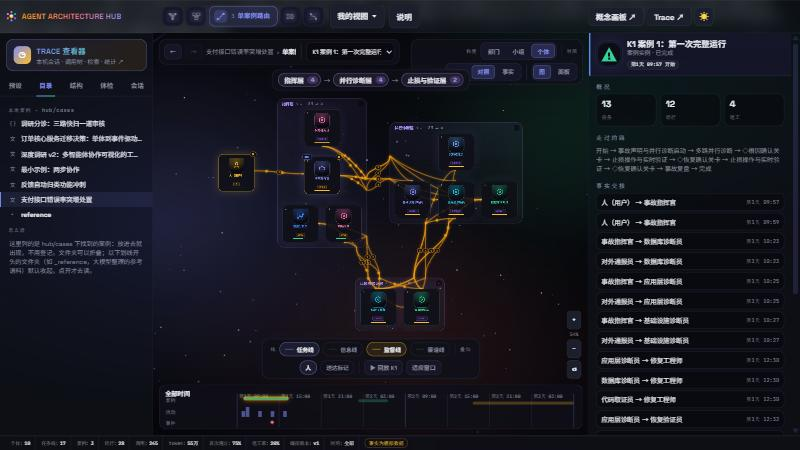
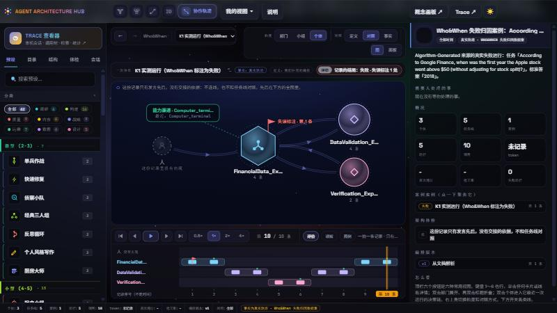
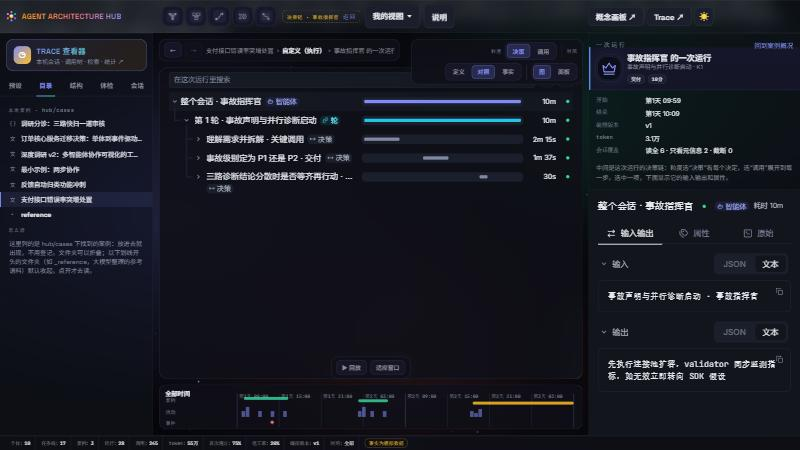
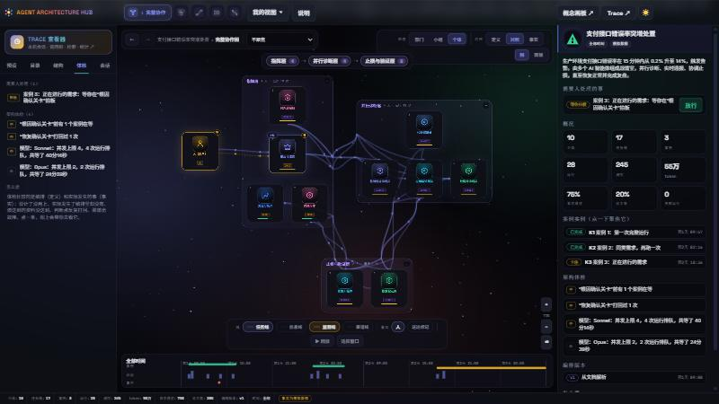
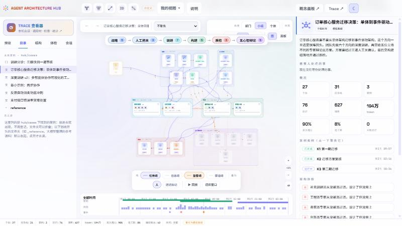

# Agent Architecture Hub

**An observatory for multi-agent collaboration: orchestration written as documents, compared with what actually happened.**

English | [简体中文](README.zh-CN.md)

Hub parses three kinds of input into one unified model — written orchestration (Markdown documents or JSON), recorded runs, and live agent sessions from your machine — and presents it through a set of linked observation panels. The model keeps three layers apart: the **definition** (what the collaboration is written to be), the **facts** (what happened) and the **analysis** computed from the two. The page is the debugger for the difference between them.


## Automatic parsing

Inputs are recognised, not registered. Put a folder or a file under `hub/cases/` and the catalog finds it; a recognizer decides what it is, and the source that loads that kind turns it into the model.

| Input | Recognised by | Parsed into |
|---|---|---|
| Orchestration documents (Markdown) | a folder containing `meta.md` | individuals, groups, relations (task, information, supervision, channel), capability channels, documents with their audiences, the process (stages, steps, gates with their exits), scenarios and decision records. An individual may name the local sessions it ran as (`session: codex:…`); its details then open that session's trace |
| hub-graph (JSON) | a `.json` file in [hub-graph format](docs/hub-graph-format.md) | the same model; unknown object types degrade to a default card instead of failing |
| Recorded traces | a `traces/` folder, read by the reader that matches the `source:` line of the case's `meta.md` | facts that replace the simulated ones: runs, turns, handoffs with their basis (explicit in the record, or implied by the source's protocol), outcomes and failure labels |
| Local agent sessions | Codex, Claude Code, OpenCode, Gemini CLI, Factory and ZCode log files, one adapter per format | one session contract; a session and its sub-agents become individuals, groups of sub-agents spawned together, dispatch and delivery lines, and model and tool channels. There is no written definition behind a session, so the definition is read from the facts. Its decision chain is a coarse-grained record that the case documents write over it (below); without one, a run opens as its recorded turns and steps |
| Built-in sample teams | 62 teams in `hub/data/base.js` | a definition and simulated facts, labelled as simulated wherever they are shown |

How the parsing behaves matters as much as what it accepts:

- **Partial input is drawn as far as it parses.** Fields the page does not know are kept and listed as raw fields in an object's details; nothing is dropped silently.
- **Facts are not inferred from adjacency.** A handoff exists only when the record states it or the source's protocol implies it; the order of speaking is kept as turns, not turned into lines. A quantity nobody recorded reads 未采集, not zero.
- **Broken structure is not drawn as a shell.** A group that names an undefined member is drawn without it, a frame with nobody in it is not drawn, a stage without steps stays a card.
- **Parsing is checked at scale.** `hub/tools/check_shells.js` builds the scenes of every case and counts empty frames, nameless or avatar-less cards, broken text and unconnected nodes. It covers the shipped cases and, with `--all`, the 1,141 machine-written cases of the author's reference corpus.
- **Machine-written cases are shelved.** Cases generated from papers and datasets live in `hub/cases/_reference/`, a folder that is listed closed in the UI and skipped by the default checks.

## Observation panels

A single observation state — case, subject, granularity, focus, time cut, comparison, lines, selection — drives every panel and is mirrored into the address bar, so a link restores exactly what is on screen.

### Canvas

The graph presentation draws one subject at a time. Views are presets of the state: switching changes one or two fields, and the elements move in place.

| View | Subject | Question it answers |
|---|---|---|
| ① Full collaboration | organisation, individual granularity | every individual and the lines between them |
| ② Departments | organisation, department granularity | how the organisation is divided; lines are merged and counted |
| ③ Case route | organisation, focused on one case instance | which individuals and handoffs one piece of work actually used; the rest dims |
| ④ Business process | process | stages, gates, who decides each gate, where work is returned or escalated to a person |
| Collaboration trajectory | collaboration | who handed what to whom, record by record, with replay; drawn only from what the record supports |
| Run detail | execution | one run as a tree of turns, steps and calls with their input and output (the embedded Trace view); decision records — alternatives, choice, reason — are shown where the case documents or the simulator provide them; a real session gets its decision chain from a diary written in the case documents (turn and steps as evidence) |

Lines are typed: task, information, supervision, capability channel. Against the facts, a solid line was written and used, a dashed one was written and never used, an orange one happened without being written. The comparison control switches between *definition*, *both* and *facts*; granularity runs from departments through groups to individuals (stages and steps; decisions and calls). Cards and department frames can be dragged; the offsets are kept per case in the browser and undone with one button.

<table>
<tr>
<td width="50%"><br>View ③. One case instance's route, handoffs numbered.</td>
<td width="50%"><br>View ④. Stages and gates, with the exits of each gate.</td>
</tr>
<tr>
<td width="50%"><br>Collaboration trajectory of a recorded failure (Who&amp;When); the annotated step is flagged.</td>
<td width="50%"><br>Run detail of a case that carries decision records: alternatives, calls, input and output.</td>
</tr>
</table>

### Sidebar and details

| Panel | Contents |
|---|---|
| **预设** (presets) | the 62 built-in sample teams by size, with category filters and search |
| **目录** (catalog) | the cases found under `hub/cases/`, as the folders they sit in; shelved folders open on demand |
| **结构** (structure) | the definition as a tree: individuals and groups, capability channels, the process, documents with audiences, case instances |
| **体检** (health) | what needs a person (approvals, escalations, directions) and the findings of the architecture check: individuals never dispatched, lines never used, handoffs no document declares, documents that did not arrive, rework loops, queues, failing channels |
| **会话** (sessions) | the agent sessions found on this machine with their live state; a session with sub-agents opens as a collaboration graph; links into the Trace viewer's source and project overview, statistics and search |
| **Details** (right) | the case overview, or the selected object: individual, group, relation, capability channel, stage, step, gate, case instance, run, a single record of a trace. Each shows its role, trigger, supervision, documents, channels, runs and raw fields, and the actions available on it: talk to it, interject, urge or reassign, redeliver a document, hand a rule change to the hub agent, pause or resume a channel, approve a gate. Every action is recorded as a fact and the analysis is recomputed |

<table>
<tr>
<td width="50%"><br>Health tab beside the graph: findings against the definition, and what needs a person.</td>
<td width="50%"><br>Light theme; the page follows the choice and remembers it.</td>
</tr>
</table>

### Panel presentation, timeline, controls

- **Panel presentation.** The same state rendered as nine panels instead of a drawing: system overview, what needs a person, individual roster (status, workload, completeness; sortable and searchable), tasks and information, delivery, capability channels, architecture check, run statistics by group, step and gate, and maintenance history.
- **Time.** The strip at the bottom shows case instances and events over time. Moving the cut re-computes every panel at that moment; replay advances it.
- **Controls.** View buttons with keys `1`–`4` and `T`; granularity, comparison and presentation switches; line and overlay toggles; saved views; back and forward through the observation history (`Alt` + arrows); `?` opens the legend and the key table.
- **Trace viewer (`/trace/`).** A separate view over every session: a filterable list, the call tree, full-text search over every step, statistics, and an overview by source and project.

## Quick start

Needs Node.js 24 or newer.

```bash
npm run setup     # once: installs the dependencies and builds the Trace viewer
npm start         # the observatory on http://127.0.0.1:8899/
```

On Windows, `start.bat` does both and opens the browser. `npm start -- --port 9000` picks another port; when the default port is held by another program, the next free one is used and printed.

The page, the sessions API and the Trace viewer are served by one process and are meant to be used together. The page reads its cases from the service and says so when it cannot reach one; it is not meant to be opened from disk or from a static host.

## Writing a case

A case is a folder under `hub/cases/` with a `meta.md` in it.

```text
hub/cases/demo_minimal/
  meta.md      the title and a short description
  agents.md    who is in the team
  groups.md    how they are grouped
  process.md   stages and gates
  relations.md, docs.md, scenarios.md, decisions/<agent>.md    (all optional)
```

`agents.md` of the smallest example:

```markdown
---
hub: "1.0"
kind: agents
case: demo_minimal
---

# @worker [individual] #phase/build #role/engineer #hub
name: 执行者
model: claude-sonnet-5-5
role: 按清单把活干完并交付
trigger: 分派任务后启动

# @checker [individual] #phase/qa #role/reviewer
name: 把关者
role: 检查交付是否符合清单，不合格打回
watches: [worker]
```

`# @id [type] #tag` opens an object; `key: value` lines and lists describe it; tags are `namespace/value`. The protocol and its JSON form are specified in [docs/hub-graph-format.md](docs/hub-graph-format.md).

**Writing a decision chain over a real session.** Name the root session in `meta.md` (`session: codex:…`), then write the decisions in `decisions/<agent>.md` with `turn` and `steps` saying where in the session each one happened. It is a diary kept at coarse grain: the decision chain on top, the session's own steps as its evidence. Records that do not match the session (a turn or step that is not there) are not drawn and are listed with the reason.

## Extending

Every seam is a registry, so a new kind of input or output is a registration:

| To add | Register |
|---|---|
| a kind of case on disk | a recognizer (`HUB.catalog.recognize`) and a source (`HUB.model.addSource`) |
| a source of facts | a provider (`HUB.facts.register`) |
| a recorded dataset | a reader in `HUB.fromTraces.readers`, matched on the case's `source:` |
| a view | `HUB.views.register` |
| a subject the stage can draw, or a layer of its own | `HUB.render.register` |
| a kind of agent-session log | a `SourceAdapter` in `trace/packages/adapters` |

[docs/ARCHITECTURE.md](docs/ARCHITECTURE.md) describes the pieces and how they fit. [docs/parsing-design.md](docs/parsing-design.md) is the design of an LLM-assisted parsing system with machine verification (not built yet).

## Security and privacy

- The service listens on `127.0.0.1` only and rejects requests whose `Host` is not its own address (DNS-rebinding guard). It sends no CORS headers, so other sites in the browser cannot read your sessions.
- It is read-only: `GET` and `HEAD` only, static files confined to their directories, path traversal rejected (also when encoded twice).
- Sessions are parsed on your machine; the index is cached under `~/.agent-hub/trace` (`HUB_TRACE_HOME` changes it). Secret-looking strings in tool inputs and outputs are masked while parsing.
- The page ships a Content-Security-Policy (`self`, plus Google Fonts for the typefaces). Without network access it falls back to system fonts.

## Repository layout

```text
index.html          the page
hub/
  js/core/          the model: state, analysis, views, catalog, facts providers
  js/sources/       parsers: case documents, hub-graph, recorded traces, sessions, the simulator
  js/shell/         the page around the canvas: camera, tabs, theme
  js/obs/           the canvas and the panels: scenes, cards, controls, sidebar pages
  css/, data/       styles; the built-in agents, sample teams and texts
  cases/            the cases (the reference corpus, when present, is in cases/_reference/)
  tools/            node checks that run the whole model without a browser
  vendor/           the Trace view as one script (built from trace/apps/viewer)
trace/              the sessions workspace: contract, adapters, OpenTelemetry export, the service, the Trace viewer
concept/            the concept board: a standalone drag-and-drop team designer with its own data, at /concept/
docs/               architecture, formats, designs
```

`npm test` runs the node checks and the workspace tests; `npm run typecheck` checks the TypeScript.

## Concept board

`/concept/` is the hand-built team board this project grew out of: a self-contained page for composing a team of agents by dragging, with its own agent and team catalogue. It is the Chinese-localized page, kept as it is and separate from the observatory; its data is not shared.

## License and credits

MIT, see [LICENSE](LICENSE). The visual language of the page, the pictograms and the built-in agent and team catalogue come from [Agent Architecture Designer](https://github.com/TheJacksonCode/Agent-Architecture) by TheJacksonCode (MIT); the observatory around them is this project's.
