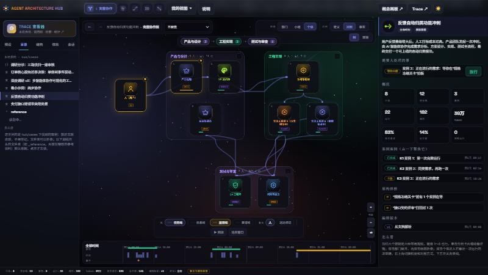
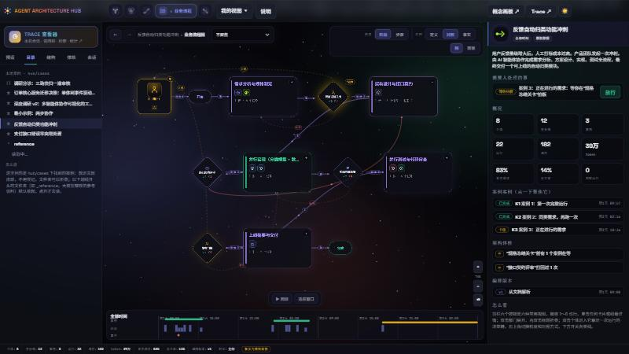

# Agent Architecture Hub

**Orchestration as documents — and a debugger for it.**

English | [简体中文](README.zh-CN.md)

Write down how a multi-agent team is organised — who does what, in which order, with which tools and models, who judges what — as plain Markdown. Hub reads those documents, draws the team, and puts what was *written* next to what *really happened*: a recorded run, or a real Codex / Claude Code session on your machine. The page is the debugger: **definition ↔ facts ↔ analysis**.



## Why

Multi-agent systems drift. The plan says the reviewer reads the researcher's output; in the runs, the builder asks the researcher directly. The plan has a quality gate; nobody ever failed it. An agent is defined and never dispatched. When the orchestration lives in prompts and heads, none of this is visible.

Hub treats the orchestration as a first-class, *written* artefact — documents anyone can read, diff and review — and compares it with facts. Every difference is a finding: a line that was never used, a handoff that no document declares, a document that never reached the agent who needed it.

## Quick start

Needs Node.js 24 or newer.

```bash
npm run setup     # once: installs the dependencies and builds the Trace viewer
npm start         # the whole observatory on http://127.0.0.1:8899/
```

On Windows, `start.bat` does both and opens the browser. `npm start -- --port 9000` picks another port.

There is one service and one address: the page, the sessions API and the Trace viewer (`/trace/`) come from the same process, so they are always up together. The page is not meant to be opened from disk or from a static host — it reads its cases from the service.

## What the page shows

- **One team, several views.** ① all individuals and their lines, ② departments, ③ how one case really travelled, ④ the business process with its gates, and the collaboration trajectory (who handed what to whom, record by record). Keys `1`–`4` and `T`; the granularity (department / group / individual) and the comparison (*definition* / *both* / *facts*) are separate controls, so switching a view changes one or two things and the cards move in place.
- **Definition against facts.** A solid line is written and happened; dashed is written but never happened; orange happened but is not written. The health tab lists what needs a person and what the check found.
- **Time.** A strip at the bottom cuts the facts at any moment and replays them.
- **A run's detail.** Double-click an individual: the decisions and calls of one run, as a trace tree.
- **Direct manipulation.** Drag cards and department titles; the offsets are remembered per case in the browser (`还原布局` puts them back). Wheel zooms, dragging the background pans. Everything the page shows is in the address bar, so a link restores it.
- **Light and dark themes.**



## Write a case

A case is a folder under `hub/cases/` with a `meta.md` in it. Drop it there and it appears in the **目录** tab — nothing to register.

```text
hub/cases/demo_minimal/
  meta.md      the title and one paragraph
  agents.md    who is in the team
  groups.md    how they are grouped
  process.md   stages and gates
  relations.md, docs.md, scenarios.md, decisions/<agent>.md    (all optional)
```

`agents.md` of the smallest example:

```markdown
---
hub: "1.0"
kind: agents
case: demo_minimal
---

# @worker [individual] #phase/build #role/engineer #hub
name: 执行者
model: claude-sonnet-5-5
role: 按清单把活干完并交付
trigger: 分派任务后启动

# @checker [individual] #phase/qa #role/reviewer
name: 把关者
role: 检查交付是否符合清单，不合格打回
watches: [worker]
```

`# @id [type] #tag` opens an object, `key: value` lines describe it. The page shows as much as it can parse; a document that is only half understood is drawn as far as it goes, and the rest shows up under *raw fields* in the details. A `.json` file in `hub/cases/` in [hub-graph format](docs/hub-graph-format.md) is a case too, and so is any other kind of entry that has a recognizer.

A folder whose name starts with an underscore is a **shelf**: it is listed closed and read only when you open it. That is where machine-written reference cases belong (see `hub/cases/_reference/README.md`); they are not part of the repository.

## Where the facts come from

| Source | What it is |
|---|---|
| Simulated | A deterministic simulation of the written orchestration, labelled *模拟数据* everywhere it shows. The 62 built-in sample teams and cases without records use it. |
| Recorded traces | A `traces/` folder inside a case, read by the reader that matches the case's `source:`. Definition and facts are then independent, so the comparison means something. |
| Local sessions | Codex, Claude Code, OpenCode, Gemini CLI, Factory and ZCode sessions found on your machine, parsed locally into one contract and shown in the **会话** tab and in the Trace viewer (list, call tree, full-text search, statistics). Read-only. Nothing leaves your machine. |

## Extending it

Every seam is a registry, so a new kind of thing is one registration, not a patch:

| To add… | Register… |
|---|---|
| a kind of case on disk | a recognizer (`HUB.catalog.recognize`) and a source (`HUB.model.addSource`) |
| a source of facts | a provider (`HUB.facts.register`) |
| a view | `HUB.views.register` |
| a subject the stage can draw, or a layer of its own | `HUB.render.register` |
| a kind of agent-session log | a `SourceAdapter` in `trace/packages/adapters` |

[docs/ARCHITECTURE.md](docs/ARCHITECTURE.md) explains the pieces; [docs/hub-graph-format.md](docs/hub-graph-format.md) specifies the JSON format (in Chinese).

## Security and privacy

- The service listens on `127.0.0.1` only and refuses requests whose `Host` is not its own address (DNS-rebinding guard); it sends no CORS headers, so other sites in your browser cannot read your sessions.
- It is read-only: only `GET`/`HEAD`, static files confined to `hub/`, path traversal rejected (also when encoded twice).
- Sessions are parsed on your machine; the index is cached under `~/.agent-hub/trace` (`HUB_TRACE_HOME` changes it). Secret-looking strings in tool inputs and outputs are masked while parsing.
- The page ships a Content-Security-Policy (`self`, plus Google Fonts for the typefaces). Without network access the page falls back to system fonts.

## Repository layout

```text
index.html          the page
hub/
  js/core/          the model: store, analysis, views, catalog, facts providers
  js/sources/       parsers: the case documents, hub-graph, recorded traces, sessions, the simulator
  js/shell/         the page around the canvas: camera, tabs, theme
  js/obs/           the canvas and the panels: scenes, cards, controls, side pages
  css/, data/       styles; the built-in agents, sample teams and texts
  cases/            the cases (the reference corpus, when you have it, is in cases/_reference/)
  tools/            node checks that run the whole model without a browser
  vendor/           the Trace view as one script (built from trace/apps/viewer)
trace/              the sessions workspace: contract, adapters, OpenTelemetry export, the service, the Trace viewer
concept/            the concept board: a standalone drag-and-drop designer for teams (own data), at /concept/
docs/               architecture, specification, formats
```

`npm test` runs the node checks and the workspace tests; `npm run typecheck` checks the TypeScript.

## Concept board

`/concept/` is the hand-built team board this project grew out of: a single self-contained HTML page for composing a team of agents by dragging, with its own agent and team catalogue. It is the Chinese-localized page, kept as it is and separate from the observatory — its data is not shared.

## License and credits

MIT, see [LICENSE](LICENSE). The visual language of the page, the pictograms and the built-in agent and team catalogue come from [Agent Architecture Designer](https://github.com/TheJacksonCode/Agent-Architecture) by TheJacksonCode (MIT); the observatory around them is this project's.
