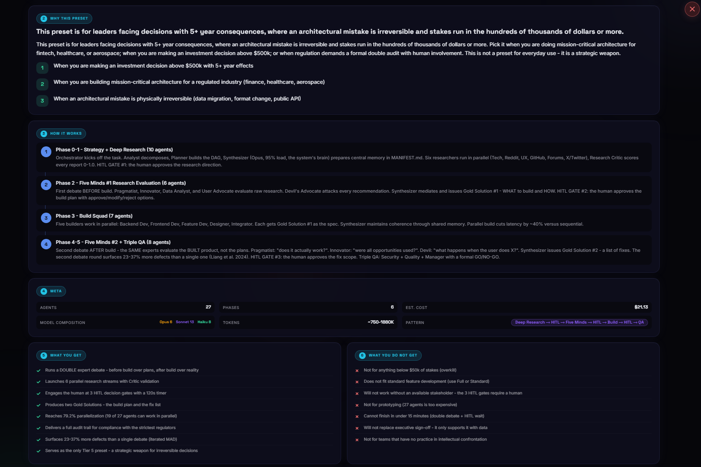
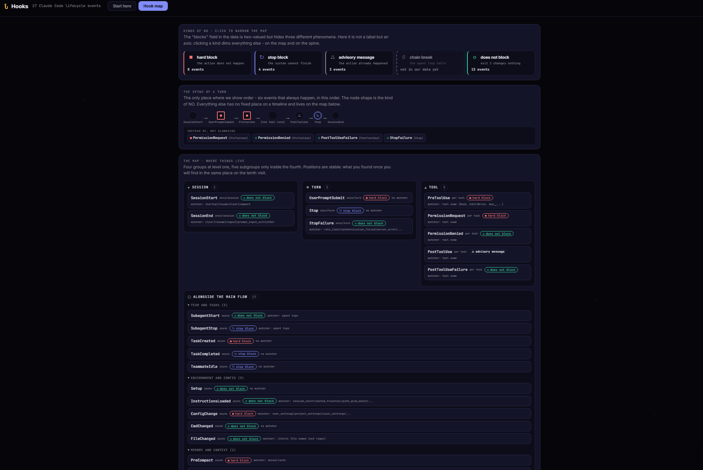
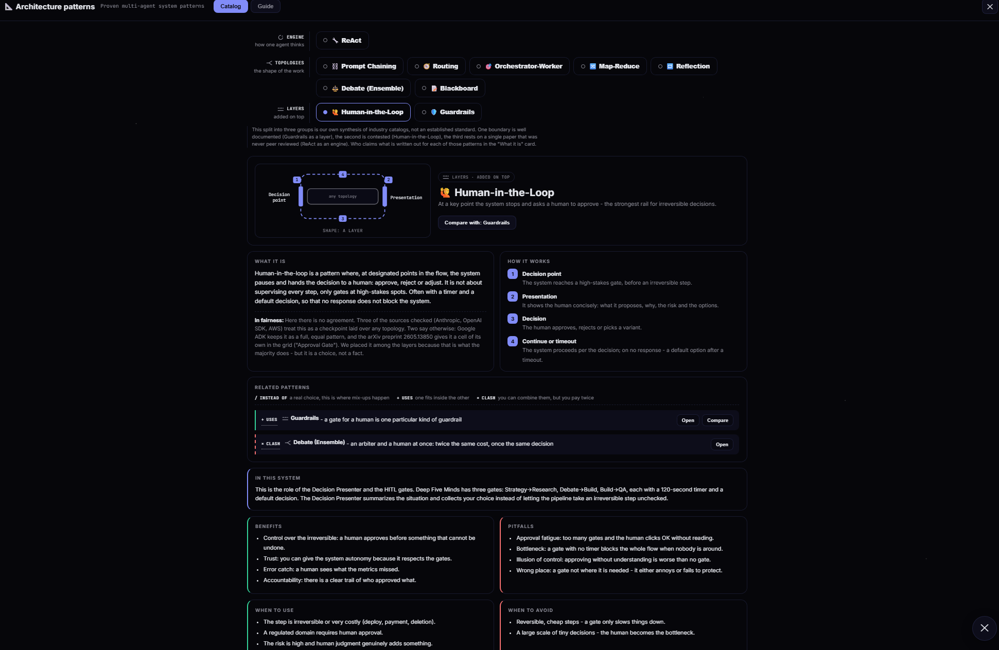
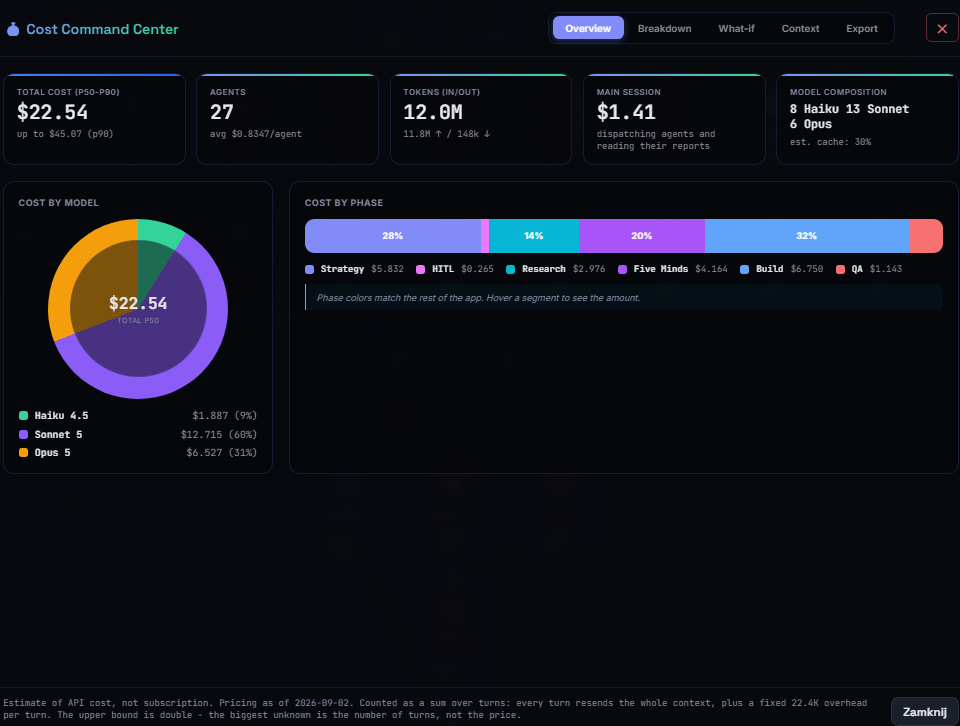
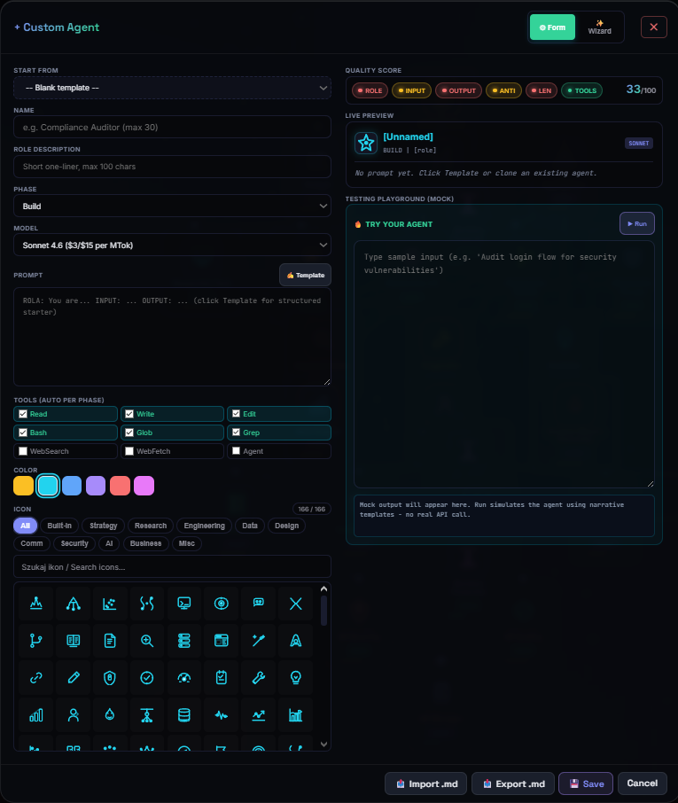
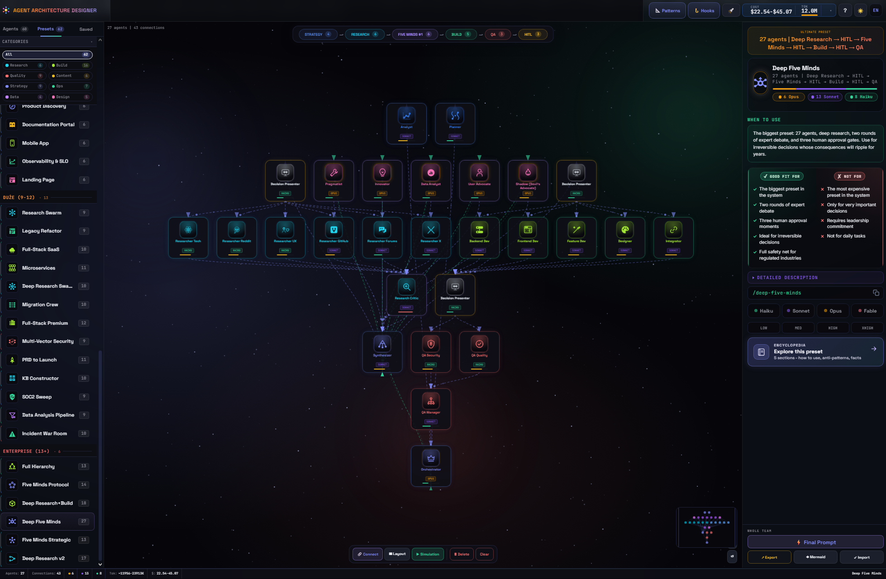
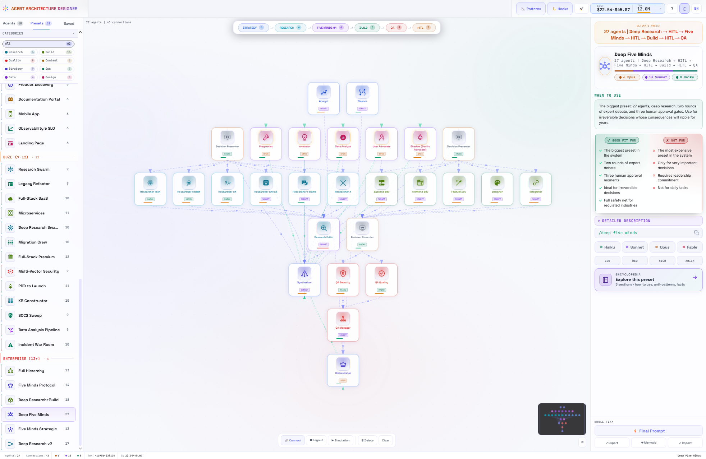
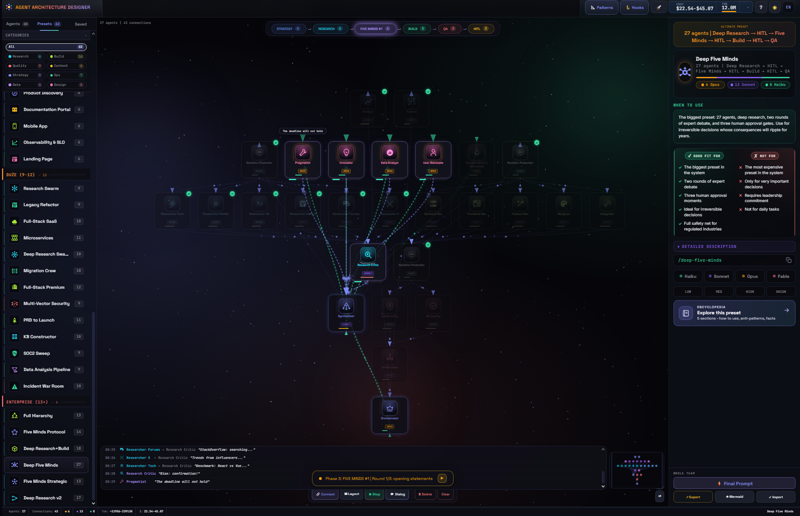

# Agent Architecture Hub

> 基于 [TheJacksonCode/Agent-Architecture](https://github.com/TheJacksonCode/Agent-Architecture) v41 衍生：在原页面与技术栈之上叠加"观察模式"——一个多智能体协作系统的可视化观察台（原作者致谢见文末）。

## 这个衍生版加了什么

- **观察模式**：原页面顶栏新增"观察｜设计"切换，六种视图（完整协作、组织架构、任务路由、业务流程、粗粒度决策链、细粒度 Trace），键盘 1~6 直接切换，原设计器不受影响。
- **文档即数据源**：`hub/cases/` 下的 Markdown（hub-graph 方言）经 `hub/js/sources/from-docs.js` 适配器编译成统一模型，页面只认统一模型。
- **hub-graph 通用格式 v1.0**：格式规范见 `hub/docs/hub-graph-format.md`，任何来源实现一个适配器并 `HUB.model.addSource` 注册即可接入。
- **Trace / 真实会话模块**：`hub/js/obs/trace.js`、`sessions.js`，可打开本机真实会话的运行图。
- **双击启动**：`启动观察台.bat` = 起本地静态服务器（127.0.0.1:8899）并打开浏览器。注意 file:// 直接双击 html 会因 fetch 被禁而看不到文档源案例，必须走 http。

## 运行

```bash
# 方式一：双击 启动观察台.bat
# 方式二：
python -m http.server 8899 --bind 127.0.0.1
# 浏览器打开 http://127.0.0.1:8899/
```

测试：`node hub/tools/test_model.js`（62 个预设）与 `node hub/tools/test_scenes.js`。

---

以下是原项目的 README：

# Agent Architecture Designer

> 如果说 Claude Code 是引擎，那么 Agent Architecture Designer 就是仪表盘——先设计好团队，在花费哪怕一个 token 之前先看它如何运转，然后精确导出 Claude Code 真正运行它所需的一切。

<p align="center">
  
</p>

<p align="center">
  <a href="https://github.com/TheJacksonCode/Agent-Architecture/blob/master/LICENSE"></a>
  <a href="https://thejacksoncode.github.io/Agent-Architecture/"></a>
  
  
  
  
  
</p>

---

> **在找可视化设计器？** 直接在浏览器中打开 [`index.html`](index.html)，或使用 [GitHub Pages](https://thejacksoncode.github.io/Agent-Architecture/) 上的在线版本——无需安装、无需构建步骤。下文内容同时也记录了由该应用生成的 Claude Code 插件（60 个子智能体 + 62 个编排预设），参见 [Claude Code 集成](#claude-code-集成)。

## 为什么要有这个项目

Agent Architecture Designer **首先是一个教育与发展类工具**。它不是生产级编排者——它是一个让你放慢脚步、像研究一台复杂机器那样研究多智能体系统的地方：一次只看一个运动部件。

目标是：用过之后，你应该能够：

- **理解每一个智能体究竟在做什么**——它的角色、输入、输出、反模式和失败模式
- **理解智能体之间如何对话**——谁把工作移交给谁、它们活跃在哪些阶段、摩擦出现在哪里
- **理解某个预设为什么长成这样**——为什么它是 6 个智能体而不是 12 个、为什么五心智（Five Minds）辩论居于中间、为什么 HITL 门设在它所在的位置
- **识别幕后的架构模式**——ReAct、Orchestrator-Worker、Blackboard、Routing 以及另外七种模式，并附有从画布上的智能体中提取的真实示例
- **准确理解 Claude Code 会在何时运行你自己的 hooks**——覆盖全部 27 个有文档记录的生命周期事件，让你在写下第一行 hook 配置之前就心中有数
- **在花费哪怕一个 token 之前**，理解多智能体系统的成本与上下文预算

你可以把它当作可视化设计器来用，但真正的价值在于每个智能体和每个预设背后的**百科全书**。每个条目都像一堂小课：它是谁、如何分阶段工作、做什么、不做什么、反模式、真实场景、何时失败，以及趣味知识。

## v41 版本的新内容

自首次公开发布（v32，仍可在 [`v32/`](v32/) 中访问）以来，这个项目成长了许多。从 v33 到 v41，它从 35 个智能体 / 42 个预设扩展到 **60 个智能体 / 62 个预设**，并在最初的画布 + 百科全书之上新增了三个教学模块：

- **引导式教程（Guided tutorial）**——应用内的 5 步导览，一次点亮一个 UI 元素，首次访问时自动启动，完全双语。入口：页眉上的手电筒图标。
- **Hooks Playground（Hooks 演练场）**——横跨 4 条泳道（会话 / 轮次 / 工具 / 异步）的全部 **27 个 Claude Code 生命周期 hook 事件**的交互式地图，每个事件都标注了节奏、触发条件、匹配器语法和阻塞行为。
- **架构模式（Architecture Patterns）**——**10 种经典多智能体模式**的参考（ReAct、Prompt Chaining、Orchestrator-Worker、Routing、Map-Reduce、Reflection、Debate/Ensemble、Human-in-the-Loop、Blackboard、Guardrails），每种模式都链接回画布上实现它的真实智能体。

此外还完成了整轮性能优化（画布拖拽与平移更流畅、百科滚动更快）和无障碍改进（页眉与画布控件全面对齐 WCAG 的对比度、焦点顺序与目标尺寸）。逐版本详情见下文的[版本管理](#版本管理)。

## 你能用它做什么

1. **学习**。点击 60 个智能体或 62 个预设中的任何一个，阅读完整的百科条目。这是主要用途。
2. **设计**。将智能体拖到画布上、连接它们、分配模型（Opus / Sonnet / Haiku / Fable），并生成一份可直接用于 Claude Code 的系统提示词。
3. **模拟**。运行实时模拟：智能体交换动画消息并穿过 HITL 决策门，让你在正式定稿前看清整个流程。
4. **预算**。打开成本指挥中心（Cost Command Center），查看按智能体 / 按阶段的成本估算、上下文窗口压力，以及假设分析场景（全 Opus、全 Sonnet、全 Haiku）。
5. **研究 hooks 系统**。打开 Hooks，无需改动任何设置文件即可浏览全部 27 个生命周期事件。
6. **研究智能体背后的模式**。打开 Patterns，看看每个预设究竟由 10 种经典多智能体架构中的哪几种构建而成。
7. **导出**。复制系统提示词、团队 Mermaid 图、Markdown 报告、CSV 或 JSON。

无需安装。无需 npm。无需构建步骤。它是一个可离线运行的**单一 HTML 文件**。

## 语言 - 波兰语和英语

界面完全双语，一键即可切换语言。**波兰语比英语更全面**——因为作者是波兰人，也因为在研究阶段可以使用更庞大的波兰语知识库。具体来说：

- 全部 60 个智能体 + 62 个预设的百科条目在两种语言中均已存在
- Hooks 和 Patterns 模块完全双语，包括每个 hook 的节奏/触发条件/匹配器描述
- 波兰语是默认撰写语言；英语译文为技术性/直接的美式英语，且不使用 em/en 破折号

如果你是英语用户并且感觉缺少了什么，请提一个 issue——我们想知道你希望扩充哪些部分。

## 在线演示

在 GitHub Pages 上[**打开 Agent Architecture Designer**](https://thejacksoncode.github.io/Agent-Architecture/)。

想获得完整体验，可以从预设 **Deep Five Minds** 开始（27 个智能体、两场五心智辩论、三个 HITL 门）；点击任意智能体打开它的百科条目，然后按下 **Simulation**，观看团队运转。

## 核心特性

- **可视化画布**——拖放 60 个智能体、绘制连接、框选分组、按智能建议自动布局、右键上下文菜单
- **智能体百科**——60 个智能体和 62 个预设中的每一个都有 bento 网格条目：我是谁、类比、我如何工作（逐阶段）、我做什么、我不做什么、真实场景、我何时失败、事实、深度剖析、团队构成
- **预设百科**——62 个预设中的每一个都有双栏绿灯 / 红灯裁决面板、阶段流程条（每个预设中各阶段的智能体数量），以及带模型提示的智能体名册
- **引导式教程**——5 步交互式导览，首次访问时自动启动，PL/EN
- **Hooks Playground（Hooks 演练场）**——横跨 4 条泳道的全部 27 个 Claude Code 生命周期事件，每个事件标注节奏/触发条件/匹配器/阻塞行为
- **架构模式（Architecture Patterns）**——10 种经典多智能体模式，每一种都与画布上的真实智能体和预设关联
- **五心智协议（Five Minds Protocol）**——结构化对抗式辩论：4 位领域专家 + 一位魔鬼代言人（"Shadow"）共同产出黄金方案（Gold Solution）
- **HITL 决策门**——阶段之间的人工检查点、倒计时、自动决策兜底、Decision Presenter 智能体
- **实时模拟**——智能体沿连接交换动画气泡和数据包；Dialog Timeline 会记录一切
- **Mission Control（任务控制中心）**——全屏影院式模拟仪表盘，带实时指标、阶段时间线和通信日志
- **成本指挥中心（Cost Command Center）**——按智能体 / 按阶段的成本估算、上下文窗口用量、模型组合、假设分析滑块、导出为 Markdown / CSV / JSON
- **自定义智能体创建器 Pro（Custom Agent Creator Pro）**——7 项功能的构建器（克隆、带质量评分的实时预览、图标选择器、色板、MD 导出/导入、向导模式、模拟测试演练场）
- **深色 / 浅色主题**——完整的 CSS 变量系统、对比度感知的 ink token、色觉安全的阶段调色板
- **PL/EN 双语**——每一条 UI 字符串、每一个百科条目、每一个成本弹窗标签、每一个 hook 和模式
- **无障碍**——对齐 WCAG 的对比度和目标尺寸、键盘导航、focus-visible、跳转链接、减弱动效支持
- **零依赖**——无 npm、无 CDN、无构建步骤。一个 HTML 文件

## 画布上有什么

### 60 个智能体

| 类别 | 智能体 | 模型组合 |
|----------|--------|-----------|
| **编排与策略** | Orchestrator, Synthesizer, Synthesizer Lean, Decision Advisor | 编排用 Opus，综合用 Sonnet |
| **规划** | Analyst, Planner | Sonnet |
| **研究** | Researcher Tech, UX, Reddit, X, GitHub, Forums, Docs, Research Critic, Extractor, Recipe Scout | 扫描用 Haiku，综合型角色用 Sonnet |
| **构建** | Backend Dev, Frontend Dev, Feature Dev, Designer, Integrator, Writer, DB Architect, Observability Engineer, Mobile Developer, Technical Writer，另有 7 个（语音、职业、内容和食谱方向的专家） | Sonnet，轻量守护者用 Haiku |
| **QA / 审计** | QA Security, QA Quality, QA Performance, QA Manager, Accessibility Tester | 轻量检查用 Haiku，QA Manager 用 Sonnet |
| **五心智** | Pragmatist, Innovator, Data Analyst, User Advocate, Shadow（魔鬼代言人） | Opus |
| **HITL** | Decision Presenter | Haiku |
| **数据与 AI** | ML Engineer, Data Engineer, AI Engineer, Prompt Engineer, Statistician, EDA Analyst | Sonnet |
| **基础设施 / 运维** | DevOps Engineer, Cloud Architect, SRE Engineer, Kubernetes Specialist, Telemetry Surfer | Sonnet |
| **产品** | Product Manager, UX Researcher, GTM Strategist | Sonnet |
| **合规** | Control Mapper | Sonnet |

在整个目录中：**42 个 Sonnet、11 个 Haiku、7 个 Opus**——Fable 可作为第四个模型层级使用，但目前尚无默认分配。

每个智能体都附带一份基于研究的提示词，遵循 ROLE / INPUT / OUTPUT / RESPONSIBILITIES / RULES / ANTI-PATTERNS / WHAT YOU DO NOT DO / REPORT FORMAT 结构。提示词是自包含的，因此被隔离的子智能体无需额外上下文即可执行。完整格式见 [`docs/SKILLS_ARCHITECTURE.md`](docs/SKILLS_ARCHITECTURE.md)。

### 62 个预设，按规模分组

- **极简（2-3 个智能体，7 个预设）**——Solo + Validator、Quick Fix、Recon Squad、Classic Trio、Reflective Loop、Voice、Master Chef
- **核心（4-6 个智能体，28 个预设）**——Bug Hunter、Content Pipeline、Plan & Execute、Performance Boost、Content Social、Career、Decision Research、Accessibility Audit、Codebase Onboarding、Growth Campaign、Pitch Deck、Startup MVP、Cascade Cost、Testing Suite、Accessibility Sprint、MLOps Pipeline、RAG / AI App Build、DevOps CI/CD Setup、Cloud / K8s Deploy、Product Discovery、Documentation Portal、Mobile App、Observability & SLO、Landing Page、Security Hardening、Code Review、Design System、API Modernization
- **进阶（7-11 个智能体，20 个预设）**——UI/UX Overhaul、Feature Sprint、A/B Test Lab、Bento Redesign、Standard Dev、Data Pipeline、Performance Squad、Tech Writing Pipeline、Research Swarm、Legacy Refactor、Multi-Vector Security、SOC2 Sweep、Data Analysis Pipeline、Full-Stack SaaS、Deep Research Swarm Pro、Migration Crew、KB Constructor、Incident War Room、Microservices、PRD to Launch
- **企业级 / 旗舰（12-27 个智能体，7 个预设）**——Full-Stack Premium、Full Hierarchy、Five Minds Strategic、Five Minds Protocol、Deep Research v2、Deep Research+Build，以及旗舰 **Deep Five Minds**（27 个智能体、2 场五心智辩论、3 个 HITL 门）

## Hooks 演练场（Hooks Playground）

Claude Code 暴露了 27 个生命周期 hook 事件，分为 4 条泳道：

| 泳道 | 覆盖范围 | 示例事件 |
|------|-----------------|-----------------|
| **会话（Session）** | 每会话一次 | `SessionStart`, `SessionEnd` |
| **轮次（Turn）** | 每个助手轮次一次 | `UserPromptSubmit`, `Stop`, `StopFailure` |
| **工具（Tool）** | 每次工具调用 | `PreToolUse`, `PostToolUse`, `PostToolUseFailure` |
| **异步（Async）** | 与主流程并行 | 后台/通知式事件 |

对于全部 27 个事件，演练场都会展示节奏、精确的触发条件、匹配器语法（工具名模式、`startup|resume|clear|compact` 等）、是否可以阻塞执行，以及典型用途（注入上下文、脱敏机密、拦截危险命令、强制"测试通过前持续工作"、退出时上报指标）。这里没有任何虚构内容——它忠实映射了 Claude Code 真实的 hook 契约。

## 架构模式（Architecture Patterns）

一份参考卡，涵盖多智能体系统中反复出现的 10 种模式：

**ReAct** - **Prompt Chaining** - **Orchestrator-Worker** - **Routing** - **Map-Reduce** - **Reflection** - **Debate (Ensemble)** - **Human-in-the-Loop** - **Blackboard** - **Guardrails**

每个模式条目都会解释其理念、何时应该选用、何时不该选用，以及画布上哪些智能体/预设真正实现了它——因此你得到的不是教科书式的示意图，而是一次点击即可看到的可运行示例。

## 截图

### 智能体百科（bento 布局）


### Hooks 演练场（Hooks Playground）


### 架构模式（Architecture Patterns）


### 成本指挥中心（Cost Command Center）


### 自定义智能体创建器 Pro（Custom Agent Creator Pro）


### 画布（深色与浅色主题）
 

### 实时模拟


## Claude Code 集成

Agent Architecture Designer 附带一套完整的编排层：**60 个智能体技能**、**62 个团队预设**以及一个路由目录，可直接在 Claude Code 中使用。

**完整指南：**[INSTALL.md](INSTALL.md)——涵盖安装、新版本发布后的更新、故障排除，以及如何向目录中添加你自己的智能体。

### 快速开始 - 以插件方式安装（最快）

本仓库自身就是一个合法的 Claude Code 插件（`.claude-plugin/plugin.json`、60 个捆绑智能体、62 个捆绑预设）——无需 clone，无需生成器脚本：

```
/plugin marketplace add TheJacksonCode/Agent-Architecture
/plugin install agent-architecture-designer@Agent-Architecture
```

### 快速开始 - 从源码生成

如果你想在编辑 HTML 后自行重新生成智能体/预设，或者向目录中添加自己的智能体，请使用这条路径：

```bash
git clone https://github.com/TheJacksonCode/Agent-Architecture.git
cd Agent-Architecture

# 1. Generate agent skills (60 files -> ~/.claude/skills/)
node generate_skills.js

# 2. Generate team presets (62 files -> ~/.claude/commands/)
node generate_commands.js

# 3. (optional) Generate the routing catalog, for task-description auto-routing
node generate_catalog.js
```

生成之后，预设是**全局的**——它们在每个项目中都可用，而不只是本仓库。第 1-2 步足以支持显式的 `/preset-name` 命令；第 3 步会生成路由片段，将其粘贴到你自己的 `~/.claude/CLAUDE.md` 即可解锁自动路由（详见 [INSTALL.md](INSTALL.md)）。

### 使用预设

在 Claude Code 中输入 `/` 并选择一个预设，或者描述你的任务，让 Claude 自动路由到最合适的一个：

| 层级 | 示例预设 | 智能体数 |
|------|----------------|--------|
| 极简 | `/solo`, `/quick-fix`, `/trio` | 2-3 |
| 核心 | `/bug-hunt`, `/test-suite`, `/startup` | 4-6 |
| 进阶 | `/security`, `/design-sys`, `/research` | 7-11 |
| 企业级 | `/saas`, `/full`, `/five-minds`, `/deep-five-minds` | 12-27 |

每个预设都会编排一支智能体团队依次经过各个阶段（策略 -> 研究 -> 构建 -> QA -> HITL），阶段之间设有决策门。完整目录和自动路由架构见 [`docs/ROUTING_SYSTEM.md`](docs/ROUTING_SYSTEM.md)。

### 架构

```
.claude-plugin/plugin.json   # Plugin manifest (what the marketplace install reads)
agents/*.md                  # 60 agent prompts, bundled in-repo for the plugin install
commands/*.md                # 62 preset files, bundled in-repo for the plugin install
~/.claude/skills/*.md        # Same 60 agent prompts, generated locally (source-from-clone path)
~/.claude/commands/*.md      # Same 62 preset files, generated locally (source-from-clone path)
~/.claude/PRESET_CATALOG.md  # Routing catalog (task -> best preset)
generate_skills.js           # Regenerate skills from HTML source (v41); --out for the agents/ copy
generate_commands.js         # Regenerate commands from HTML source (v41); --out --plugin for commands/
generate_catalog.js          # Regenerate the routing catalog from HTML source (v41)
```

`agents/` 和 `commands/` 文件夹的生成方式与 `~/.claude/` 下的对应内容完全相同——只是指向了不同的 `--out` 目录——因此两条安装路径始终保持一致。

完整的技能格式、模型路由以及如何添加新智能体，见 [`docs/SKILLS_ARCHITECTURE.md`](docs/SKILLS_ARCHITECTURE.md)。

## 技术细节

- **格式**——单一 HTML 文件，约 3.5 MB（包含全部 PL + EN 百科内容、内联 SVG 图标）
- **依赖**——零。无 npm、无 CDN、无构建步骤
- **技术栈**——原生 JS（ES2022）+ 内联 SVG + CSS 过渡 + Canvas 2D + 容器查询
- **状态**——localStorage 持久化（画布、主题、图标模式、语言偏好、自定义智能体），带版本化迁移链
- **渲染**——混合架构：Canvas 2D 负责粒子/星空，SVG 负责连接与图标，CSS 变换负责智能体节点拖拽（rAF 批处理、不触发布局）
- **无障碍**——对齐 WCAG 的对比度和目标尺寸、focus-visible、prefers-reduced-motion、键盘导航、跳转链接
- **模型**——Opus 5（每 MTok 输入/输出 $5/$25）用于编排和辩论，Sonnet 5（$2/$10）用于大多数智能体，Haiku 4.5（$1/$5）用于轻量研究和 HITL 门控，Fable 5.1（$10/$50）可作为第四层级使用
- **安全**——对所有 `innerHTML` 注入点做 HTML 转义清扫、CSV 公式注入防护、Mermaid 标签净化、带配额处理的安全 localStorage 读写
- **双语引擎**——扁平 `I18N_EN.ui` 查找，外加百科、Hooks 演练场和架构模式模块的专用命名空间

## 版本管理

每个主版本都以单一 HTML 文件的形式保存在自己的文件夹里。`v32/` 是首次公开发布；`v41/` 是当前版本，根目录 `index.html` 为 GitHub Pages 镜像的正是它。两者之间的开发版本（v33-v40）只保留在本地——只有已发布的里程碑才会推送。

详细的 v1-v32 更新日志见 [VERSIONS.md](VERSIONS.md)。

### 版本亮点，v32 到 v41

| 版本 | 关键新增 |
|---------|---------------|
| v32 | 首次公开发布——35 个智能体、42 个预设、完整双语百科、成本指挥中心、自定义智能体创建器 Pro |
| v33 | 范围扩展到软件任务之外——在原有的开发向目录旁新增研究、职业和生活方式类预设 |
| v34 | **Hooks Playground 上线**——全部 27 个 Claude Code 生命周期事件、"每智能体投入度"作为第二路由维度、更大规模的数据与 AI / 基础设施智能体名册 |
| v35 | 新增无障碍与产品智能体类别；目录增长到 58 个智能体 / 55 个预设 |
| v36 | 画布节点打磨——全面统一节点尺寸、按类别进行颜色编码 |
| v37 | 预设图标集、右侧面板清理、为每个智能体补齐 token 价格 |
| v38 | 稳定化一轮——作为 Patterns 模块开发前的工作基线 |
| v39 | Hooks Playground 定稿并通过验收；冻结为回退版本 |
| v40 | **架构模式（Architecture Patterns）模块上线**——10 种经典多智能体模式，每一种都与真实智能体和预设关联 |
| **v41** | **引导式教程**（5 步应用内导览）、完整的观感与无障碍打磨、画布与百科性能调优，目录达到 **60 个智能体 / 62 个预设** |

## 反馈

这个项目仍在成长，**我们真诚期待你的反馈**——尤其是教育方面：

- 百科是否帮你弄懂了某个曾经让你困惑的智能体？是哪一个？
- 在这 60 / 62 的目录中，是否缺少某个智能体角色或协作模式？
- Hooks Playground 或架构模式模块是否改变了你对自己 Claude Code 配置的思考方式？

请提交 [GitHub issue](https://github.com/TheJacksonCode/Agent-Architecture/issues) 或发起一个[讨论](https://github.com/TheJacksonCode/Agent-Architecture/discussions)。简短的评论和截图都非常欢迎。

## 许可证

[MIT](LICENSE) - 版权所有 (c) 2026 TheJacksonCode

## 作者

由 **[TheJacksonCode](https://github.com/TheJacksonCode)** 构建。

---

<sub>界面语言：波兰语（更全面）和英语（核心百科、Hooks 和 Patterns 模块完全对等）| 文档语言：英语 | 主要用途：教育与发展——理解多智能体系统如何思考</sub>

---

## 致谢

本仓库基于 **[TheJacksonCode/Agent-Architecture](https://github.com/TheJacksonCode/Agent-Architecture)**（Agent Architecture Designer v41）构建：星空画布、`.nd` 卡片体系、平移缩放、深浅主题与设计器本体全部来自原作者 [TheJacksonCode](https://github.com/TheJacksonCode) 的工作，感谢原作者的开源分享。

原项目以 MIT License 发布，其版权声明保留在 [LICENSE](LICENSE)；本仓库的衍生部分同样以 MIT License 发布。
