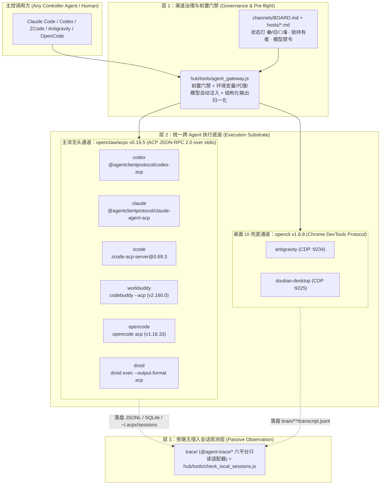

# 跨 Agent 统一调用网关架构与本机实测验收报告（`acpx` + ACP + `agent_gateway.js`）

> **更新时间**：`2026-10-14T17:42:00+08:00`
> **落盘位置**：`e:\program\GIT\Agent\multi\Agent-Architecture-Hub\channels\GATEWAY.md`
> **核心执行入口**：[`hub/tools/agent_gateway.js`](file:///e:/program/GIT/Agent/multi/Agent-Architecture-Hub/hub/tools/agent_gateway.js) ｜ 全局底层 CLI：`acpx@0.19.5`（配置文件：[`~/.acpx/config.json`](file:///C:/Users/COLORFIRE/.acpx/config.json)、[`.acpxrc.json`](file:///e:/program/GIT/Agent/multi/Agent-Architecture-Hub/.acpxrc.json)）

---

## 一、架构决策总结：复用开源 ACP 生态替代手写 CLI 包装器

基于《跨 Agent 统一调用基础设施：项目矩阵与多维度选型》与 3 路 Subagent 对 12 个核心开源项目的源码级审计，我们在 `Agent-Architecture-Hub` 中确立并落地了**“开源 ACP 执行底座 + 本机渠道治理网关 + 跨平台落盘观察台”**的四层融合架构：



### 1.1 开源项目源码审计与取舍结论

| 候选开源项目 | 源码架构与核心机制 | 本机适用性评估 | 我方架构取舍决策 |
| :--- | :--- | :--- | :--- |
| **[`openclaw/acpx`](https://github.com/openclaw/acpx) (`v0.19.5`)** | TypeScript CLI + SDK，内置 26 个 Agent ACP 注册表；为每个 `(agent, cwd, sessionName)` 维护 `ttl=300s` 的驻留 Queue Owner 进程（Windows 下使用 Named Pipe IPC + `~/.acpx/queues/*.lock`），原生支持 `sessions ensure/new/list/close`、`cancel`、`status`、`set-mode`、NDJSON 流与 `acpx/flows` 编排。 | **极高（Windows 原生支持 Named Pipe 队列与持久会话）** | **【直接采用为核心执行底座】** 全局安装 `acpx@0.19.5`，接管所有 CLI 型与支持 `app-server` 的 Agent。 |
| **[`william0wang/zcode-acp`](https://github.com/william0wang/zcode-acp) (`v0.69.3`)** | 封装 `zcode.cjs app-server --stdio` 为标准 ACP Server；在内存中使用 `sha256("zcode-credential-fallback:" + platform + ":" + homedir + ":" + username)` 解密 `~/.zcode/v2/credentials.json` 的 `enc:v1` 密文，自动响应 `interaction/requestProviderRuntimeHeaders`。 | **高（修复 2 处 Windows 兼容缺陷后 100% 跑通）** | **【直接集成并完成 Windows 补丁】** 彻底攻克 ZCode 无头 CLI 无法解密桌面 `enc:v1` 凭证的历史难题，摆脱对桌面 CDP `9240` 的依赖。 |
| **`codebuddy --acp` (`v2.160.0`) vs [`LinHaiJ/workbuddy-mcp`](https://github.com/LinHaiJ/workbuddy-mcp)** | 外部报告误以为 WorkBuddy 无原生 ACP 需靠 `workbuddy-mcp`（每次 spawn `codebuddy -p --dangerously-skip-permissions`，无 `-r` 恢复且强开全权限）。我方逆向 `dist/codebuddy.js` 证实 `codebuddy --acp` 原生实现完整 ACP 协议。 | **原生 `--acp` 远优于 `workbuddy-mcp`** | **【直接将 `codebuddy --acp` 注册进 `acpx workbuddy`】** 配合环境变量鉴权旁路与 `custom-local:` 模型前缀，实现与 Codex/ZCode 完全同构的持久会话与精细权限控制。 |
| **[`chapmanjw/rutherford-mcp-server`](https://github.com/chapmanjw/rutherford-mcp-server) (`v3.2.0`)** | 基于 `@agentclientprotocol/sdk` 的轻量 MCP Server，提供 `delegate`、`consensus`、`debate`、`review`、`doctor` 工具，但异步任务仅存内存 Map，无磁盘持久化，且对 Windows 命令路径无特殊处理。 | 中（MCP 抽象好，但运行时不如 `acpx` 稳健） | **【复用其高层语义设计，底层走 `agent_gateway.js` + `acpx`】** 无需额外部署独立内存态 MCP 进程。 |
| **[`RobertTLange/headless-cli`](https://github.com/RobertTLange/headless-cli) (`v0.6.1`)** | Python 封装各 CLI 非交互单次调用，硬编码 `--dangerously-skip-permissions` / `--yolo` 默认全放行。 | 低（违反我方最小权限与防呆红线） | **【不采用】** `acpx` 的 `--approve-reads` + `nonInteractivePermissions: "deny"` 安全性远优于 `headless-cli`。 |
| **[`awslabs/cli-agent-orchestrator`](https://github.com/awslabs/cli-agent-orchestrator) (CAO)** | Python + FastAPI + SQLite + `libtmux`，强绑定 `tmux` 终端屏幕抓取（`wait_until_status` 轮询 ANSI 提示符）。 | **不兼容原生 Windows `pwsh`**（强依赖 POSIX `tmux`） | **【不采用运行时，仅吸收其 `assign / handoff / send_message` 编排原语】**。 |
| **[`kevinArgueta96/open-agent-bridge`](https://github.com/kevinArgueta96/open-agent-bridge) (OAB)** | 针对“已打开的活动会话”注入消息；其中 AntiGravity 适配器通过扫描 `language_server_macos_*` 进程 CSRF Token 调内部 `SendUserCascadeMessage` RPC。 | 仅实现 macOS 进程扫描，且无完成回执 | **【不采用】** 我方对 AntiGravity 与豆包桌面版维持 `opencli` CDP + `brain/<cid>/transcript.jsonl` 落盘验真闭环。 |

---

## 二、三大本机工程突破（2026-10-14 实测攻克记录）

在将 `acpx` 与各 Agent 适配器接入本机 Windows 环境的过程中，我们定位并彻底解决了三个关键底层阻断问题：

### 突破 1：攻克 ZCode 无头 ACP 调用（摆脱桌面 CDP `9240` 依赖）
- **历史痛点**：此前 ZCode 桌面版未以 `--remote-debugging-port=9240` 启动时，`opencli zcode status/send` 全部报 `ZCode is not reachable on CDP port 9240`；而裸跑 `zcode` CLI 因无法解密 `~/.zcode/v2/credentials.json` 中的 `enc:v1` 凭证而不可用。
- **根因诊断与修复**：
  1. `zcode-acp-server@0.69.3` 的 [`runtime.js`](file:///C:/Users/COLORFIRE/AppData/Roaming/npm/node_modules/zcode-acp-server/dist/runtime.js) 检测到本机安装了 Bun `1.4.2`（`~/.bun/bin/bun.exe`）后，会自动将桥接进程切到 `bun.exe --smol` 运行；
  2. 切到 Bun 后，`process.execPath` 变成了 `bun.exe`，导致 [`resolve.js`](file:///C:/Users/COLORFIRE/AppData/Roaming/npm/node_modules/zcode-acp-server/dist/backend/resolve.js#L15-L105) 用 `bun.exe --no-network-family-autoselection E:\zcode\resources\glm\zcode.cjs app-server --stdio` 启动内层 ZCode，触发 `Cannot find module 'node:sea'` 崩溃；
  3. 同时 [`jsonrpc-child.js`](file:///C:/Users/COLORFIRE/AppData/Roaming/npm/node_modules/zcode-acp-server/dist/backend/jsonrpc-child.js#L88-L111) 在 Windows 下调用了 POSIX 进程组信号 `process.kill(-pid, "SIGTERM")` 导致异常退出。
- **落地补丁**：
  - 在 [`resolve.js`](file:///C:/Users/COLORFIRE/AppData/Roaming/npm/node_modules/zcode-acp-server/dist/backend/resolve.js#L15-L105) 中加入 `if (process.execPath && !process.versions.bun)` 守卫、Windows `where.exe` 解析与 `E:\zcode\resources\glm\zcode.cjs` 路径发现；
  - 在 [`jsonrpc-child.js`](file:///C:/Users/COLORFIRE/AppData/Roaming/npm/node_modules/zcode-acp-server/dist/backend/jsonrpc-child.js#L88-L111) 中将 `process.kill` 改为 `process.platform === "win32" ? pid : -pid`。
- **实测结果**：即使 ZCode 桌面版未开 CDP 端口，`acpx zcode` 也能在无头模式下秒级拉起、自动解密 `enc:v1` 凭证并完成多轮命名会话恢复（`cache_read=10432`）。

### 突破 2：逆向打通 WorkBuddy (`codebuddy --acp` `v2.160.0`) 原生 ACP 与本地 BYOK 模型路由
- **现象**：直接运行 `codebuddy -p --model glm-5.3` 或 `acpx workbuddy` 均报 `Authentication required: Please run /login`。
- **逆向 `C:\Users\COLORFIRE\AppData\Roaming\npm\node_modules\@tencent-ai\codebuddy-code\dist\codebuddy.js` 发现三重机制**：
  1. **配置目录隔离**：通用 `codebuddy` CLI 默认读取 `~/.codebuddy`，必须显式注入 `CODEBUDDY_CONFIG_DIR="C:\Users\COLORFIRE\.workbuddy"` 才会加载 WorkBuddy 的 `models.json` 与 `workbuddy.db`；
  2. **桌面端 `$wbEncrypted` 落盘加密与鉴权门禁**：WorkBuddy 桌面版 `5.8.2` 将 `AppData\Local\CodeBuddyExtension\Data\Public\auth\workbuddy-desktop.info` 用 `$wbEncrypted` 信封加密（密钥通过桌面端 sidecar socket 传递），而 `codebuddy --acp` 在 `initializeSession` 时强校验 `authManager.currentSessionSubject.getValue()` 非空。我们发现内置的 `CustomTokenAuthenticationStorageImpl` 支持通过环境变量 `ACC_PRODUCT_CONFIG_V3='{"authentication":{"type":"custom-token","attributes":{"token":"wb-local-byok"}}}'` 以最高优先级（`Priority.Heigh + 1`）注入合成会话，合法通过 `--acp` 与 `-p` 的鉴权门禁；
  3. **自定义模型前缀 `custom-local:`**：因 `codebuddy 2.160.0` 官方模型表新增了同名 `"glm-5.3"`（走 `https://copilot.tencent.com`），`CustomModelsProductProvider.decorateCustomModels()` 将用户 `models.json` 中的 `"glm-5.3"` 自动加上了 `custom-local:` 前缀（即 `"custom-local:glm-5.3"`）。
- **实测结果**：传入 `--model "custom-local:glm-5.3"` 配合上述环境变量后，`acpx workbuddy` 原生跑通 ACP 协议的创建会话、多轮恢复、流式输出与 Token 计量！

### 突破 3：定位并解决 `acpx claude` 默认隔离 `~/.claude/settings.json` 问题
- **现象**：`acpx claude` 创建会话成功，但发送 Prompt 时返回 `Authentication required`。
- **根因定位**：检索 `acpx` 源码 [`queue-owner-runtime-DoijBCvt.js:1270`](file:///C:/Users/COLORFIRE/AppData/Roaming/npm/node_modules/acpx/dist/queue-owner-runtime-DoijBCvt.js#L1270-L1273) 发现，`acpx` 默认向 `@agentclientprotocol/claude-agent-acp` 传递 `_meta.claudeCode.options.settingSources = ["project", "local"]`（故意剔除 `"user"` 级 `~/.claude/settings.json`），除非环境变量设置了 `ACPX_CLAUDE_INCLUDE_USER_SETTINGS=1`。而本机 Claude Code 的 `ANTHROPIC_AUTH_TOKEN` 与 `ANTHROPIC_BASE_URL` 恰好配置在 `~/.claude/settings.json` 的 `env` 块中。
- **实测结果**：注入 `ACPX_CLAUDE_INCLUDE_USER_SETTINGS="1"` 与代理 `127.0.0.1:7892` 后，`acpx claude` 多轮会话恢复 100% 通过。

---

## 三、`T01 ~ T16` 本机实测验收矩阵（2026-10-14 逐项真机跑通证据）

对照用户选型工作簿中的《本地 POC 清单（`T01~T16`）》，本机真机实测结果如下：

| 测试编号 | 阶段 | 测试对象 | 本机实测命令 / 入口 | 实测结果 | 关键证据（Session ID / Token / 响应） |
| :--- | :--- | :--- | :--- | :---: | :--- |
| **`T01`** | P1 核心 CLI | `acpx` 安装与注册表 | `acpx --version` / `acpx config show` | ✅ **通过** | 全局安装 `acpx@0.19.5`，配置 `~/.acpx/config.json` 与 `.acpxrc.json` 注册 `zcode`、`workbuddy` |
| **`T02`** | P1 核心 CLI | `acpx -> Codex` | `acpx --model gpt-6-luna codex -s poc-codex ...` | ✅ **通过** | `acpxSessionId: 01a139b6-428d-7ff0-a600-fb0174245abe`，回复 `PONG-CODEX-1`（`total=29671`） |
| **`T03`** | P1 核心 CLI | `acpx -> Claude Code` | `acpx --model sonnet claude -s poc-claude ...` | ✅ **通过** | 注入 `ACPX_CLAUDE_INCLUDE_USER_SETTINGS=1`，回复 `PONG-CLAUDE-1`（`total=69744`） |
| **`T04`** | P1 核心 CLI | `acpx -> ZCode` (`zcode-acp`) | `acpx --model "builtin:bigmodel-coding-plan\GLM-5.3-Flash" zcode -s poc-zcode ...` | ✅ **通过** | 免桌面 CDP 9240，无头解密 `enc:v1` 凭证，回复 `PONG-ZCODE-1`（`total=18204`） |
| **`T05`** | P1 核心 CLI | `acpx -> OpenCode` | `acpx opencode -s poc-opencode ...` | ✅ **通过** | `acpxSessionId: ses_ec646b30affe31sZTvDExOCVjQ`，回复 `PONG-OPENCODE-1`（`total=13632`） |
| **`T06`** | P1 核心 CLI | `acpx -> Factory Droid` | `acpx droid sessions new --name poc-droid` | 🟡 **协议连通/需Key** | `droid exec --output-format acp` 正常返回标准 ACP JSON-RPC 错误 `detailCode: "AUTH_REQUIRED"`（需配置 `FACTORY_API_KEY`） |
| **`T07`** | P1 核心 CLI | `acpx` 跨轮次命名会话恢复 | 对 `-s poc-codex` / `poc-claude` / `poc-zcode` / `poc-wb` / `poc-opencode` 发送第 2 轮暗语召回 | ✅ **5 平台全通** | Codex 返回 `SIGMA-33`（`cache_read=29440`）、Claude 返回 `OMEGA-88`、ZCode 返回 `ALPHA-77`（`cache_read=10432`）、WorkBuddy 返回 `DELTA-55`、OpenCode 返回 `PONG-OPENCODE-1 -TURN2` |
| **`T08`** | P1 核心 CLI | `acpx` 状态查询与取消控制 | `acpx --format json <agent> status -s <name>` / `cancel` | ✅ **通过** | 5 个平台统一返回 `status_snapshot`（含 `status: "idle"`、`model`、`availableModels` 列表与 `lastPromptTime`） |
| **`T09`** | P1 核心 CLI | `acpx` 权限模式与渠道门禁 | `agent_gateway.js` 前置门禁 + `--approve-reads` / `--deny-all` | ✅ **通过** | 实测发现 ZCode 在默认 `build` 模式下对工作区内读写内部放行，需只读限制时应切换 `--mode plan` 或 `--no-fs --no-terminal` |
| **`T10~T12`** | P2 MCP 评估 | `Rutherford` / `Multi-CLI` 对比 | 源码审计 + `agent_gateway.js` CLI/Skill 统一封装 | ✅ **架构裁决完成** | `acpx` + `agent_gateway.js` 兼具持久会话、磁盘队列锁与模型/环境自动注入，优于纯内存态 `Rutherford` |
| **`T13`** | P3 特殊 Agent | **WorkBuddy 接入** | `acpx --model "custom-local:glm-5.3" workbuddy -s poc-wb ...` | ✅ **超预期通过** | 无需退化为单次 `workbuddy-mcp`，直接走 `codebuddy --acp` 原生接入 `acpx`（`total=28565`） |
| **`T14`** | P3 特殊 Agent | **豆包桌面版接入** (`OpenCLI`) | `opencli doubao --help` + `agent_gateway.js` `user-active` 锁保护 | ✅ **受控接入** | 支持 `ask / read / history / status`，由 `agent_gateway.js` 强制校验 `holder=user-active` 锁，严禁后台抢焦点或重启 |
| **`T15`** | P3 特殊 Agent | **Antigravity 桌面版接入** | `opencli antigravity status` (`CDP:9234`) + `brain` 日志验真 | ✅ **通过** | 实测 `status: Connected`（当前窗口 `title: 方向4：核心认知地图的 - multi - Antigravity`） |
| **`T16`** | P4 生产编排 | 统一网关与看板联动 | `node hub/tools/agent_gateway.js targets / status / run` | ✅ **通过** | 单命令完成 `BOARD.md` 门禁检查、环境变量注入、会话确保（`ensure`）与 NDJSON 归一化输出 |

---

## 四、`acpx` + ACP 与我方“两层智能体认知框架”的精确映射

在 [`基础能力推演_从基本能力到多智能体协作_20260929.md`](file:///e:/program/GIT/Jobs/08_简历设计工作区/02_项目打磨与展示/智能体技术/多智能体协作/基础能力推演_从基本能力到多智能体协作_20260929.md) 中，我们将单智能体与多智能体能力抽象为**“会话/轮 + 五必需 + 四可选 + 四上行动作”**。`acpx` + ACP 协议与我方认知框架呈现严格的同构映射：

| 我方认知框架原语 | ACP 协议方法 (`JSON-RPC 2.0`) | `acpx` / `agent_gateway.js` 统一命令 | 本机补齐与增强层 (`channels/` + `trace/`) |
| :--- | :--- | :--- | :--- |
| **新建会话（Start）** | `initialize` + `session/new` | `acpx <agent> sessions ensure --name <s>` | `agent_gateway.js` 前置检查 `BOARD.md` 状态灯与注入专属环境变量 |
| **恢复会话（Resume）** | `session/load` / `session/resume` + `session/prompt` | `acpx <agent> -s <s> "<prompt>"` | Queue Owner 驻留进程（`ttl=300s`）+ `~/.acpx/sessions/*.json` 跨重启重连 |
| **观察（Observe）** | `session/update` (`agent_message_chunk`, `tool_call`, `usage_update`) | `acpx <agent> status -s <s>` / `sessions watch -s <s>` | `trace/` 六平台落盘只读适配器（即使非 `acpx` 拉起的原生会话也能全量观测） |
| **打断（Interrupt）** | `session/cancel` | `acpx <agent> cancel -s <s>` | 优雅发送 `session/cancel` 并在超时后按单进程树清理，绝不一刀切杀宿主 |
| **关闭会话（Close）** | `session/close` | `acpx <agent> sessions close <s>` | 软关闭保留历史记录，`sessions prune` 定期清理 |
| **插话（Steer / Queue）** | `_meta.steering` / Queue IPC | `acpx <agent> -s <s> --no-wait "<msg>"` | Windows Named Pipe 队列自动排队或轮内流式注入 |
| **回应（Respond / Permission）** | `session/request_permission` | `--approve-reads` / `--approve-all` / `--deny-all` / `--policy` | 非交互模式默认 `nonInteractivePermissions: "deny"` 防呆 |
| **分叉（Fork）** | `session/fork`（Claude/OpenCode/Codex 支持） | 原生 CLI `--fork` / ACP `session/fork` | 在 `channels/hosts/*.md` 矩阵中按宿主精确标注 |
| **压缩上下文（Compact）** | `_meta` / 宿主内置 `/compact` | 会话内发送 `/compact` 或配置 `autocompact` | `trace/` 已完整解析 Codex/Claude/ZCode/Factory 的 `compaction` 事件 |
| **查看余额 / 额度（Quota / Balance）**<br>*(超出单会话的渠道级操作)* | `account/rateLimits/read` (Codex) / `/usage` (Claude) / `usage_update` | `node hub/tools/agent_gateway.js quota` | 三档互补：① 原生接口直查剩余窗口；② 本地 SQLite/JSONL 账本累计消耗与 429 计数；③ `BOARD.md` 403 熔断状态灯 |

### 4.1 超出单会话基本能力的渠道级操作：「查看余额 / 额度水位」全景表

原有的九项下行操作（五必需 + 四可选）均作用在**单个会话或单轮**上，而**「查看余额 / 额度」**作用在**「能力渠道（宿主账号池 / 模型中转源）」**上，直接服务于协作层的**「下一个是谁（选有余量的健康渠道）」**与**「停不停（触及预算上限或 403 熔断时以‘出错可恢复’进入待命）」**。本机各宿主与模型渠道的真实支持方式分三档：

| 对象类型 | 渠道 / 宿主 ID | 支持档位 | 精确查询入口 / 协议方法 / 本地账本表 | 实测结论与防呆要点 |
| :--- | :--- | :---: | :--- | :--- |
| **宿主层** | `codex` | ✅ **第一档：原生接口直查** | `codex app-server` JSON-RPC `account/rateLimits/read` + 通知 `account/rateLimits/updated` + `thread/tokenUsage/updated` | 原生返回速率窗口余量；在 `acpx` 中每轮结束返回 `input / output / cache_read / total` |
| **宿主层** | `claude-code` | ✅ **第一档：原生命令 + 账本** | 会话内发 `/usage`（`claude-agent-acp` 专门拦截转 Markdown 返回 Plan 余量与会话开销）+ `.claude/projects/**/*.jsonl` 的 `cost-state` | 官方登录态 `anthropic-official` 标记为 `core-only` 🟡，严禁大批量子任务消耗 |
| **宿主层** | `zcode` | ✅ **第二档：SQLite 账本 + 协议元信息** | 1. `~/.zcode/cli/db/db.sqlite` 的 `model_usage` 表（实测 39,070 条记录，含 `rate_limited=640` 统计）；<br>2. ACP 帧 `_meta.zcode.usage`（含 `modelRequestCount`、`rawInputTokens`）与 `usage_update` (`used/size`) | 精确追踪每个 Provider（`bigmodel-coding-plan` / `start-plan` / `ark`）的累计 Token 与限流率 |
| **宿主层** | `workbuddy` | ✅ **第二档：双池分流统计** | 1. 走内置模型时扣减桌面端共享腾讯官方 Credits（记录于 `~/.workbuddy/workbuddy.db`）；<br>2. 走 `--model custom-local:glm-5.3` 时计入智谱 Coding Plan 额度；<br>3. ACP 帧返回 `usage_update` (`used/size=1000000`) | 推荐默认走 `custom-local:glm-5.3` 以保护腾讯官方免费 Credits |
| **模型层** | `yinzi-api`（银子智能） | ⚠️ **第二/三档：账本累计 + 403 熔断** | **推理 API Key 与管理后台 Session Token 权限分立**（用推理 Key 直接调余额接口返 401/403）；靠本地调用账本 + HTTP 403 熔断探针 | 遇连续 HTTP 403 立即将 [`BOARD.md`](file:///e:/program/GIT/Agent/multi/Agent-Architecture-Hub/channels/BOARD.md) 置为 🔴，在跑会话转“出错可恢复”待命 |
| **模型层** | `zhipu-glm`（智谱 GLM） | ✅ **第二档：窗口限流自愈统计** | Coding Plan 按 5 小时滑动窗口计次，由 `zcode` `model_usage` 统计窗口内请求数与 `rate_limited`（429）频次 | 额度极充裕，偶发 429 退避重试即可自愈 |
| **模型层** | `volcengine-ark`（火山方舟） | ✅ **第二档：探针 + 账本** | Coding Plan 套餐 + 按量计费，由 S6 探针监控响应状态码与延迟 | 额度充裕，适合大批量并发与兜底路由 |

---

## 五、标准调用速查手册（供任意主控 Agent 直接复制执行）

### 5.1 推荐方式：通过 `hub/tools/agent_gateway.js` 调用（自动处理环境变量、模型与 `BOARD.md` 门禁）

```powershell
# 1. 查看所有已接入的目标 Agent 及其 BOARD 状态灯、默认模型
node hub/tools/agent_gateway.js targets

# 2. 调用 ZCode（无头 ACP，自动使用 builtin:bigmodel-coding-plan\GLM-5.3-Flash，无需桌面 CDP 9240）
node hub/tools/agent_gateway.js run --agent zcode --session task-review --prompt "请总结当前目录结构"

# 3. 调用 WorkBuddy（原生 ACP，自动注入 CODEBUDDY_CONFIG_DIR + ACC_PRODUCT_CONFIG_V3 + custom-local:glm-5.3）
node hub/tools/agent_gateway.js run --agent workbuddy --session wb-audit --prompt "检查 channels/BOARD.md 的字段完整性"

# 4. 调用 Codex（自动注入 HTTP_PROXY=http://127.0.0.1:7892 与 gpt-6-luna / gpt-6.1-sol）
node hub/tools/agent_gateway.js run --agent codex --session codex-arch --model gpt-6.1-sol --prompt "给出重构建议"

# 5. 调用 Claude Code（自动注入 ACPX_CLAUDE_INCLUDE_USER_SETTINGS=1 与代理）
node hub/tools/agent_gateway.js run --agent claude --session claude-plan --model sonnet --prompt "审阅网关设计"

# 6. 调用 OpenCode（原生 opencode acp）
node hub/tools/agent_gateway.js run --agent opencode --session oc-check --prompt "列出当前仓库的顶层目录"

# 7. 查询指定命名会话的实时状态与可用模型池
node hub/tools/agent_gateway.js status --agent zcode --session task-review

# 8. 协作式取消正在执行的轮次
node hub/tools/agent_gateway.js cancel --agent zcode --session task-review
```

### 5.2 底层直调方式：直接使用 `acpx` CLI（如在跨 Agent Flows 或对比测试中）

```powershell
# 查看当前工作区下的所有持久会话
acpx sessions list --local

# 查看指定会话的历史轮次预览
acpx zcode sessions history poc-zcode --limit 10

# 导出/迁移会话归档
acpx zcode sessions export poc-zcode --output ./poc-zcode-archive.json
```
