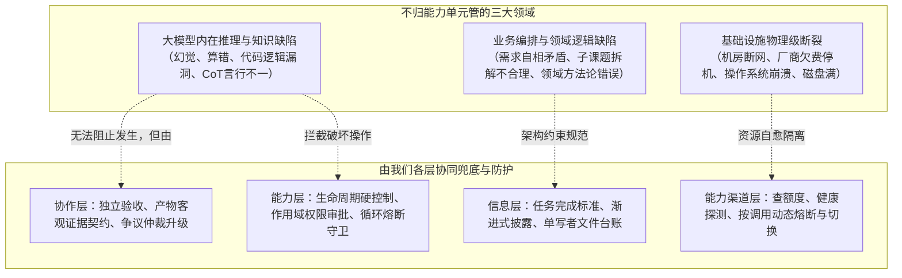

# 从失败倒推：多智能体能力单元与协作抽象的边界核对与缺口审计

- **研究任务**：从失败倒推，检查我们的能力单元和协作抽象有没有漏
- **日期**：2026-10-18
- **性质**：只读分析报告（未运行任何智能体实例，未执行破坏性命令，未打开 AP-Vibe 运行中的 SQLite 数据库）
- **交付文件**：`channels/probe/results/agy-pro-units-failures-20261018.md`
- **基准文档**：
  - 认知入口：`channels/README.md`
  - 能力单元真源：设计目录《能力单元登记表_20261017.md》（46 项现存单元）
  - 协作抽象：`channels/README.md` §一之二；设计目录《核心抽象_能力层与协作层_20261008.md》§3～§4
  - 对照起点：设计目录《综合回顾_协作拓扑_能力单元_文档拓扑.md》§5（初步对照假设）

---

## 〇、结论摘要（大白话）

1. **从失败倒推证明：我们的基本能力单元和协作抽象基座大致完整，但在“运行时硬约束”和“基础设施自愈”上有 5 处关键缺口。** 我们把学术界（MAST 14 类、Who&When、TraceElephant）、SOTA 实战（第 1 轮 8 种交接与 7 种结构踩坑）、AP-Vibe 底层问题（P01～P23）以及控制链自身近期故障（R1～R7、10-17/18 实测）共五大源头、42 类典型失败全部推导了一遍，绝大部分失败都能在“能力层操作、状态机判据、协作层三个决定、信息层三层分布与产物契约”中找到发现和防御手段。
2. **推翻《综合回顾》第 5 节的简易对照假设。** 原假设将 MAST 失败机械对应到“工作包”、“求助”、“隔离”、“停不停”、“验收”5 个概念，忽视了“发现”与“防住”的机制差异（例如发现步骤重复靠事件监听，防住靠进度账本与守卫），更漏掉了多智能体工程中高频发生的生命周期错位、两套状态机脱节、并发竞争导致限流、以及假闭环合谋等系统级灾难。
3. **清晰划定责任边界：明确了“不该由能力单元管”的三类事物。** 模型内在推理脑子分叉（如单步算错、CoT 逻辑幻觉）属于大模型基础能力，能力单元防不住它产生，但协作层与能力层靠“审批”、“独立验收”与“真实证据工件（客观退出码/测试报告）”能防住其破坏；业务编排逻辑与领域工作流属于协作层与任务模板，能力层只负责忠实承载其原语；纯网络波动与上游平台抖动属于基础设施运维，靠能力渠道层的重试与熔断接住，绝不能混淆为“智能体能力单元有缺陷”。
4. **梳理出 5 项核心缺口，建议立项补充**：包括能力层的**循环熔断守卫（`guard-loop-breaker`）**、协作层的**标准化任务拉起契约与实例账本（`task-launch-contract`）**、能力渠道层的**渠道并发租约锁（`channel-lock`）**、宿主运行级的**优雅排空原语（`host-drain`）**，以及能力层安全策略的**作用域权限分级（`permission-scope`）**。
5. **指出当前抽象中存在的 4 处多余与重叠**：`inject-next` 与队列化 `resume` 逻辑重叠；`inject-inbox` 混淆了操作原语与文件协议；`peer-message` 容易助长“智能体底层私聊”的幻觉，它本质是中心的“请求-问答”组合；`task-board` 属于协作层信息范畴，错位登记进了单会话能力单元。

---

## 一、分析方法与边界判据

### 1.1 为什么必须“从失败倒推”
根据用户原话：“认知是否全面是可以通过阅读后推理分析的，因为是抽象的东西”，“得探索到边界”。
以往我们设计能力单元，往往走“自上而下推演”（如生命周期的必需五项可选四项）或“看外部协议自下而上盘点”（如核对 ACP / MCP 的接口）。这两种方式都容易产生**虚假的完备感**：把接口列得很齐，却在实战遇到 429 限流、僵尸进程卡死、相互放水假验收、以及重启打断全员时措手不及。
**从失败倒推，是检验抽象完备性的试金石**：每一类真实发生过多智能体系统崩溃，都必须回答：
- 依靠我们的哪个**能力单元**或**读取到的状态**能敏锐**“发现”**它？
- 依靠我们的哪个**能力单元**、**协作拓扑机制**或**信息规则**能彻底**“防住”**它？
- 它在架构上到底属于哪一层（能力层、协作层、信息、能力渠道、抑或不归我们管）？
如果一类失败在我们的抽象体系中既没人发现、也没人防住、甚至连归属都讲不清楚，这就是**真正的认知与抽象缺口**。

### 1.2 推翻《综合回顾》第 5 节的初步假设
设计目录《综合回顾_协作拓扑_能力单元_文档拓扑.md》第 5 节曾给出一张简易对照表：
- 工作包是否完备 $\leftrightarrow$ 2.4 信息隐瞒、2.5 忽视他人输入、1.4 丢失对话历史
- 能不能求助 $\leftrightarrow$ 2.2 没有请求澄清
- 必读清单和上下文隔离 $\leftrightarrow$ 2.3 任务偏离、2.1 对话重置
- 停不停 $\leftrightarrow$ 1.5 不知道终止条件
- 验收 $\leftrightarrow$ 3.1 过早终止、3.2 没有或不完整的验证、3.3 错误的验证

**本次推翻并修正如下：**
1. **混淆了“发现”与“防住”**：例如 1.5“不知道终止条件”，工作包里写明完成标准是“防住”，但一旦智能体在运行中由于长上下文遗忘导致停不下来，靠什么“发现”？必须依赖能力层的实时状态监控（`observe-live`）、会话步数/用量阈值（`goal` 预算），以及协作层的超时看护（`wake-stall`）。
2. **遗漏了 MAST 核心高频项**：原表完全漏掉了 MAST 第一高频项 1.3 步骤重复（本地轨迹中占 52.6%）、1.1 违背任务规定（42.4%）、2.6 推理与行动不一致（33.0%），以及 1.2 违背角色规定。
3. **脱离了工程真实世界的血泪经验**：原表只看纯学术的 MAST 14 条文本，对真实部署中暴露出的“角色长实例短生命周期错位”、“状态机脱节提前唤醒”、“并发限流无锁导致 429”、“重启无排空打断全员”、“只读权限下写自身记忆崩溃”等严重系统故障视而不见。

### 1.3 责任归属分界线（边界在哪里）
在进行逐项倒推时，严格遵守以下分层归属判据（沿用《核心抽象_能力层与协作层_20261008.md》§1 和《术语表》）：
- **能力层（下层）**：针对单个执行者或渠道。解决“怎么驱动它、观察它、在它运行中途做什么、读回什么、会话状态是什么”。
- **协作层（上层）**：针对一群个体为一个目标协作。解决“谁来做（下一个是谁）、给他什么、停不停、交接拓扑、验收闭环”。
- **信息（载体）**：在个体和层之间流动的数据。包括任务定义、三层信息（共识/私有/地图）、只追加台账、证据工件（Artifact）。
- **能力渠道**：运行载体（模型、执行器、账号、额度）与调用资源。状态包括余量、限速、健康、熔断。
- **不归我们管**：
  1. **模型内部推理局限**：LLM 自身的数学逻辑能力差、单步反思幻觉。
  2. **外部平台绝对不可用**：模型厂商机房起火、断网断电、第三方 API 彻底下线。
  3. **具体业务逻辑代码自身的缺陷**：如用户需求本身自相矛盾。

---

## 二、多智能体失败与抽象大表

本节对 5 大源头共 42 类典型失败进行逐一倒推分析。

| 编号 | 失败类别 / 名称 | 现象与典型例子出处 | 能发现它的单元或状态 | 能防住它的单元或机制 | 架构归属 | 抽象判断 |
| :--- | :--- | :--- | :--- | :--- | :--- | :--- |
| **一** | **学术标准：MAST 14 类多智能体失败分类（NeurIPS 2024/2025；本地 851 条轨迹标注证据）** | | | | | |
| M01 | 1.1 违背任务规定 (Disobey Task Spec) | 产出违反了任务要求或硬性格式约束（本地 MAST 占 42.4%）。例：任务明确要求“用 JSON 返回三项”，模型只给两项或写成纯文本。`成果/任务书3/失败关联/结果.md:30` | 协作层“停不停”的静态体检脚本；能力层 `observe-live` 监听到返回格式不符 | 信息层任务类别的清晰规格与 schema；协作层产物契约与自动闸门拦截退回；能力层 `guard`（输出校验钩子） | 信息层 + 协作层 + 能力层 | **已有着落** |
| M02 | 1.2 违背角色规定 (Disobey Role Spec) | 智能体越俎代庖，超出人设职责边界（本地 MAST 占 4.0%）。例：代码审查员本应只挑错，却私自把整个文件全部重写。`成果/任务书3/失败关联/结果.md:38` | 协作层监督线（核查角色发现越权）；能力层 `observe-live` 监听到非预期的工具调用（如只读审查员调用了文件写入工具） | 协作层个体定义（清晰职责与禁止项）；能力层 `mode-switch`（强制只读模式）；能力渠道按角色分配工具权限（审查员环境完全不挂载写入工具） | 协作层 + 能力层 | **已有着落** |
| M03 | 1.3 步骤重复 (Step Repetition) | 陷入死循环，重复执行相同或高度相似动作（本地 MAST 占 52.6% 第一高频）。例：代码报错后，智能体连续 6 轮反复尝试同一种错误修改。`成果/任务书3/失败关联/结果.md:27` | 能力层 `observe-live` / `state`；协作层看护计时器（发现同一步骤无进展） | 信息层进度账本（Progress Ledger，显式记录尝试历史）；能力层 `steer`（轮内插话纠偏）；**缺失：底层自动检测死循环的熔断守卫** | 能力层 + 信息层 | **部分（缺口 1）** |
| M04 | 1.4 丢失对话历史 (Loss of History) | 遗忘早先轮次已建立的事实或上游关键输入（本地 MAST 占 7.2%）。例：第 5 轮推翻了第 1 轮已经达成共识并写定的技术选型。`成果/任务书3/失败关联/结果.md:37` | 协作层验收阶段比对前后一致性；能力层 `observe-history` 审计 | 信息层共识与地图（关键事实落盘为外部文件，不依赖模型单会话上下文窗口）；能力层 `compact`（结构化摘要压缩，禁止无损丢弃）；交接包机制 | 信息层 + 能力层 | **已有着落** |
| M05 | 1.5 不知终止条件 (Unaware of Termination) | 任务早已完成却停不下来，无限续跑或反复打转（本地 MAST 占 31.7%）。例：测试全绿后，智能体继续执行无效的目录查找操作。`成果/任务书3/失败关联/结果.md:32` | 能力层 `state`（执行轮数异常超标）；协作层“停不停”的步数上限报警 | 信息层任务定义中明确给出终止判定条件；能力层 `goal`（目标与预算硬约束，到点强制停止）；能力层 `guard`（Stop 钩子阻断） | 信息层 + 能力层 | **已有着落** |
| M06 | 2.1 对话重置 (Conversation Reset) | 会话上下文意外清空或突变，表现得如同全新实例（本地 MAST 占 3.9%）。例：调试到第 4 步时，智能体突然问“您好，请问有什么可以帮您？”。`成果/任务书3/失败关联/结果.md:39` | 能力层 `state`；`observe-history` 发现上下文突变为 1 轮 | 能力层会话生命周期严格管理（统一会话身份 `(agent, entrypoint, native_id)`；底层适配器规范“恢复失败绝不静默退化为新建会话”）；冷恢复持久化 | 能力层 | **已有着落** |
| M07 | 2.2 没请求澄清 (Fail to Ask Clarification) | 面对缺失前提或含糊需求不提问，自行编造假设导致全盘做错（本地 MAST 占 18.4%）。例：没给数据库密码，智能体凭空编造一个继续跑。`成果/任务书3/失败关联/结果.md:36` | 协作层验收（发现最终结论建立在虚假前提上） | 信息层任务书“三问之求助”（明确指定卡壳或缺少信息时向谁澄清）；能力层 `ask-user`（向人提问）/ `peer-message`（向中心/上游提问）；协作层提要求的乙路 | 信息层 + 能力层 | **已有着落** |
| M08 | 2.3 任务偏离 (Task Derailment) | 随着交互深入，逐渐脱离核心目标转向无关枝节（本地 MAST 占 26.2%）。例：原本是优化前端按钮，后来花 3 小时去重构后端的日志库。`成果/任务书3/失败关联/结果.md:34` | 能力层 `observe-live`（监控工具调用与改动路径）；协作层阶段性闸门（检查改动范围是否超出子课题） | 协作层粗粒度任务拆解（单任务粒度放小）；能力层 `steer`（发现偏离立即插话拉回）；信息层工作包约束（限制文件写入范围） | 协作层 + 能力层 | **已有着落** |
| M09 | 2.4 信息隐瞒 (Information Withholding) | 智能体持有下游完成活计所必需的异常或关键事实，交接时却私自滤掉（本地 MAST 占 1.5%）。例：后端接口压测存在 5% 报错，报告中只写“压测通过”。`成果/任务书3/失败关联/结果.md:40` | 协作层独立核查（核查者直接查验底层执行日志）；交叉验证 | 协作层产物契约铁律：“交付必须附带客观结构化证据（真实日志、退出码、diff），严禁只信自述口头汇报”；信息由中枢直接引用原始文件传递，不靠中间人转述 | 协作层 + 信息层 | **已有着落** |
| M10 | 2.5 忽视他人输入 (Ignored Other's Input) | 明确收到了其他角色的打回意见或数据，却视而不见继续自说自话（本地 MAST 占 30.9%）。例：审阅者明确要求改换算法，下一轮输出原样提交。`成果/任务书3/失败关联/结果.md:33` | 协作层往返评审闭环（审阅者二次验收时比对意见清单采纳度）；确定性 diff 检查 | 协作层往返形状与退回机制（未通过核查直接打回，不准流转至下游）；信息层结构化工作包（将修改意见转化为强制 checklist 逐项对齐）；能力层 `inject-next` | 协作层 + 信息层 | **已有着落** |
| M11 | 2.6 推理行动不一致 (Reasoning-Action Mismatch) | 思考过程说要调用 A 工具并传参数 X，实际调用的却是 B 工具传参数 Y，言行脱节（本地 MAST 占 33.0%）。例：Thought 里写“该文件不需要修改”，下一步直接触发了覆盖写入。`成果/任务书3/失败关联/结果.md:31` | 能力层 `observe-live`（对比推理文本 thought 与工具调用 tool_call 参数）；静态代码与文件差异审计 | **大模型内在推理缺陷（能力层防不住模型脑子分叉）**；但能力层 `permission`（对敏感工具执行拦截审批）与协作层真实工件验收（只认执行结果）能彻底兜底防住破坏 | 不归我们管（模型内在）+ 能力层兜底 | **已有着落（边界明确）** |
| M12 | 3.1 过早终止 (Premature Termination) | 核心任务尚未做完，智能体提前声明“全部搞定”并主动退出（本地 MAST 占 20.6%）。例：长代码重构只写了 10 行，文末写“其余部分同理已完成”。`成果/任务书3/失败关联/结果.md:35` | 能力层 `state`（结合产物完成度发现未满退出）；协作层任务验收闸门 | 协作层“停不停”严格把关（完成标准未达标前，调度器绝不关闭任务）；能力层 `resume`（带上“未完成项列表”恢复会话强制续跑）；能力层 `goal` | 协作层 + 能力层 | **已有着落** |
| M13 | 3.2 未验证或验证不完整 (Incomplete Verification) | 产物未经真实运行检验，或验证仅流于表面打卡（本地 MAST 占 47.7%）。例：写完 Python 脚本未真实执行测试，仅凭肉眼阅读声明无语法错误。`成果/任务书3/失败关联/结果.md:28` | 协作层独立验收；确定性脚本体检（跑真实 pytest 并检查 exit code） | 协作层生产与核查分离机制（强制“不能验收自己”，交由独立验证实例负责）；产物契约要求必须提交真实执行证据；协作层质量闸门硬阻断 | 协作层 + 信息层 | **已有着落** |
| M14 | 3.3 错误的验证 (Incorrect Verification) | 验证者自身逻辑错误，把对的判为错的或把错的判为对的，导致“验证者失误”（Who&When 中 25% 错误出在验证员身上；本地 MAST 占 45.5%）。例：验证角色写了错误的断言把正常输出打回。`成果/任务书3/失败关联/结果.md:29` | 协作层争议升级机制（连续打回触发总调度或人介入）；下游工序运行时报错 | 协作层核心原则：**确定性脚本体检优先于大模型主观评审**（能用程序测的绝不交给模型猜）；验证角色的任务书明确列出精确判据与反例；两次退回强制触发仲裁 | 协作层 | **已有着落** |
| **二** | **实战沉淀：SOTA 第 1 轮交接与排布失败经验（`协作环境/协作交接分析.md`）** | | | | | |
| S01 | 认领前无“拉起”规程与账本缺失 | 调度者临场手写启动提示词，把路径和目录拼错（如建成了两个 V14 目录，依赖脱节）。`协作交接分析.md:160-175` | 协作层任务台账与运行台账对账（发现运行与任务需求失联，或目录不存在） | **缺失：协作层标准化的任务拉起契约与实例台账**；启动提示词永远只能是指向需求文件的指针，严禁临场手写目录；任务拉起由中枢原子建账 | 协作层 | **缺口（缺口 2）** |
| S02 | 角色活得长、实例活得短 | B1 角色职责跨三个阶段，其实例在第 1 阶段交付骨架后就退出了，导致后续阶段 4 份 B2 产物永久无人验收挂死。`协作交接分析.md:21-23` | 协作层巡检（发现交付物停留在“等待验收”，但对应的验收角色没有活动进程）；`wake-stall` 超时报警 | 协作层职责切分：将跨阶段角色的长期职责拆解为离散的任务项与明确的依赖关系；上游交付事件自动拉起新的验收实例接手；连续性完全由外部记忆文档承载 | 协作层 + 信息层 | **已有着落** |
| S03 | 平台运行状态机与任务状态机脱节 | AP 运行层处于“等待验收”，依赖机制却将其误判为“已完成”，导致提前唤醒下游，下游拿着半成品空转。`协作交接分析.md:24-27` | 协作层对账（检查两套状态机映射一致性） | 严格遵守单写者原则与两套状态机解耦：任务层依赖只认业务上的“completed / passed”，绝不将底层的“运行退出/等待验收”视为完成 | 协作层 | **已有着落** |
| S04 | 协作规则没有机器机制兑现 | 规矩写着“限流”却没有并发锁，导致 4 个 B2 同时打 arXiv 接口触发 429；规矩写着“不能验自己”，B1 续做却直接验收了自己。`协作交接分析.md:28-32` | 能力层监听到 429 报错；协作层对账脚本抓到自验记录 | **缺失：能力渠道层的共享资源并发排队锁与租约**；协作层调度器在选择“下一个是谁”时机器级硬排除原作者；规则全部转变为机器阻断门 | 能力渠道层 + 协作层 | **部分（缺口 3）** |
| S05 | 出错接续未保留可回读文件 | V03-S02 跑了 3 个多小时失败后没留下任何原始回读文件，接续实例只能从头重跑；续做稿写在 AP 临时工作区没落黑板。`协作交接分析.md:33-39` | 协作层巡检（发现接续实例重复产生大量上游请求，或交付物不在共享黑板） | 信息层边请求边写日志与检查点（Checkpoint）规程；协作层交付铁律：只有落盘到项目共享黑板的文件才算交付；接续实例首先加载 checkpoint | 信息层 + 协作层 | **已有着落** |
| S06 | 调试缺乏可信时间、关联编号与写入归属 | ZCode 台账时间靠模型脑补，与真实系统时钟差 3～5 小时；认领文件里没有任务与运行编号，文件被谁改的无法追溯。`协作交接分析.md:40-44` | 事后排查与复盘审计时无法还原事件因果序 | 协作层统一元数据规范：所有工件与运行日志必须由宿主自动注入“身份三件套”（角色 ID、宿主/会话编号、运行编号）和系统真实时钟，禁止模型猜测；Git 追踪写入 | 协作层 + 信息层 | **已有着落** |
| S07 | 协作拓扑三大单点瓶颈瘫痪 | A1 调度者进程停摆导致全系统停滞 12 小时；Codex 上游网络抖动引发级联崩溃；外部学术接口共用一个出口被封禁。`协作交接分析.md:45-48` | 看门狗与心跳健康探测；渠道熔断报警 | 协作层去中心化哲学：“智能体不依赖中枢，中枢停了照常干活，文件是唯一真源”；能力渠道层熔断与备用渠道自动切换（`channel-route`）；全局限速代理 | 协作层 + 能力渠道层 | **已有着落** |
| S08a | 扇出扇入陷阱：兄弟重叠或扇入无人收 | 扇出给多个 B2 调研员时边界模糊互相重叠；扇入时没有指定唯一的收口人，产物成了一堆无人归纳的散落文件。`协作交接分析.md:68` | 协作层巡检发现兄弟产物内容大面积重复，或所有子任务完成后全局任务未收尾 | 协作层分发拓扑规范：扇出时子任务边界由上级需求集中划定并相互排斥；扇入时必须在派发时就绑定唯一的汇总责任角色 | 协作层 | **已有着落** |
| S08b | 生产核查陷阱：同质模型放水合谋 | 编写代码与审查代码均使用同一个模型系列（如均为 Claude），两者具有完全相同的盲区，相互吹捧通过导致致命 bug 漏进生产。`协作交接分析.md:69` | 最终集成测试或自动化流水线测试失败 | 协作层异构模型审查配置（规定审查者必须采用不同厂商模型）；确定性测试脚本与静态分析工具介入，用客观测试结果代替纯自然语言审查 | 协作层 + 能力渠道层 | **已有着落** |
| S08c | 服务队列陷阱：服务方离线导致队列只进不出 | 论文下载队列塞入 106 篇论文，但下载服务角色未常驻也未被拉起，队列永久积压。`协作交接分析.md:70` | 协作层监控（检测到队列堆积水位超标且出队速率为 0） | 协作层服务请求交接规范：非即时服务角色改用定时批处理实例拉起，或采用事件驱动（队列非空时由中枢自动唤醒拉起服务角色处理） | 协作层 + 能力层（唤醒） | **已有着落** |
| S08d | 同一文件接力陷阱：并发写入相互覆盖 | 多个子任务同时尝试向同一个场景汇总文件追加内容，由于并发无锁导致相互覆盖，前者的内容被抹除。`协作交接分析.md:71` | 版本控制比对（Git diff 发现前一次提交的段落被整块覆盖删除） | 协作层单写者原则（严格遵守“一文件一写者”）；并发阶段各写独立分块文件，最后由汇总角色统一串行合并；或采用 Git Worktree 隔离分支合并 | 协作层 + 能力层（工作区隔离） | **已有着落** |
| S08e | 监看者越俎代庖 | 监看角色在巡检时看到调度角色停摆，顺手自己去派发任务，导致决策行为未受审计且与主调度冲突。`协作交接分析.md:73` | 协作层审计日志发现非调度角色的派发事件 | 协作层角色责任与权限硬隔离：监看角色只具备只读观察与报警上报权限（`act-report`），中枢在接收派发指令时严格校验发起者的角色权限 | 协作层 | **已有着落** |
| S08f | 跨平台互修无合法接单人 | 跨平台诊断出故障后开出了故障单，但故障单系统里没有对应的合法执行者角色，故障单挂死。`协作交接分析.md:74` | 故障单超时监控 | 协作层维护闭环：明确每个渠道、每类故障的标准维护者角色（`渠道档案卡` 登记维护者），故障自动路由至指定角色的任务池 | 协作层 | **已有着落** |
| S08g | 规则动态变更在跑实例无法感知 | 任务进行到一半，设计者修改了 AGENTS.md 规则，但正在跑的实例由于长上下文或一次性加载，继续执行旧规则。`协作交接分析.md:62, 139` | 验收时发现交付物仍按过时规则执行 | 信息层规则摘要自动同步机制；能力层 `steer`（轮内插话）或 `inject-next`（下一轮输入）注入变更说明；必要时打断（`cancel`）并带新规则恢复 | 信息层 + 能力层 | **已有着落** |
| **三** | **运行底座：AP-Vibe 基础设施问题记录（`协作环境/AP-Vibe底层问题记录.md`）** | | | | | |
| P01 | 伙伴即执行槽，无工作池概念 | 一个伙伴同时只能跑一个运行，扩容需要人工修改每个任务的候选伙伴名单，调度者负担沉重。`AP-Vibe底层问题记录.md:13-18` | 任务调度时候选人名单解析耗时与冲突 | 协作层执行者池（Executor Pool）抽象；任务派发面向角色池（如 `pool:sota-exec`）而非具体实例槽位 | 协作层 | **已有着落** |
| P02 | 实例配置全靠启动参数，重启被篡改 | 维护者重启服务时漏带启动参数，导致沙箱被静默降级为只读，智能体交付的产物写不进黑板全部作废。`AP-Vibe底层问题记录.md:19-25` | 智能体报错写权限被拒；交付物未落盘 | 宿主配置持久化文件（数据目录 `direct-delivery-projects.json`），启动时强制回读持久化配置，不单靠命令行易失参数 | 能力层（宿主实现） | **已有着落** |
| P03 | 平台重启直接打断所有在跑任务，无排空 | 服务部署或更新时缺乏排空机制，导致正在执行的 12 个长任务直接被打断作废。`AP-Vibe底层问题记录.md:26-30` | 任务状态突然批量变为 interrupted | **缺失：能力层宿主与会话级的优雅排空（graceful-drain）原语**；停止接收新任务，等待现有任务自然完成，超时方杀 | 能力层（宿主生命周期） | **缺口（缺口 4）** |
| P04 | 中断与网络失败一律算“作者失败” | 上游断流抖动导致任务被判失败并吃掉有限的重试次数，最终任务因重试耗尽死锁。`AP-Vibe底层问题记录.md:31-35` | 错误日志中捕获到平台传输异常而非模型逻辑错误 | 能力层完成判据与错误分类：区分“环境与上游网络故障”与“智能体产出错误”；上游传输错误直接退回队列重新排队，不扣减作者重试次数 | 能力层 + 能力渠道层 | **已有着落** |
| P05 | 验收结论出现三个死角死锁 | `changes_requested` 等待管理员安排修订却无时限；`inconclusive` 让任务永久停滞；`hold` 暂缓无期限。`AP-Vibe底层问题记录.md:36-43` | 任务停滞超时监控 | 协作层验收状态机完整闭环：直接交付跳过冗余拦截自动触发返工；无法判断一律按返工计；任何暂缓状态必须配置 TTL 超时强制唤醒 | 协作层 | **已有着落** |
| P06 | 权限沙箱过宽或过窄，缺乏数据作用域安全分级 | 只读沙箱加按需审批导致智能体连写自身日志都弹窗超时被拒；完全放行又可能误删项目文件。`AP-Vibe底层问题记录.md:44-50` | 智能体因无法写入自身记忆/数据而异常退出 | **缺失：能力层作用域权限策略（Scoped Permission Policy）**；自身私有数据目录默认放行写，工作区按模式放行，系统全局严格审批 | 能力层（安全策略） | **缺口（缺口 5）** |
| P07 | 看门狗只看事件流导致误杀或假活 | 工具未收尾反复冒出诊断事件导致死任务看似活着；长命令排队无事件被看门狗在 2700 秒误杀。`AP-Vibe底层问题记录.md:51-55` | 进程死锁但事件流不断，或活动进程突然被杀 | 能力层精细化状态判据：结合底层真实进程存活、CPU 占用及业务 stopReason 综合判定；超时可按任务定制；忽略单纯诊断事件 | 能力层 | **已有着落** |
| P08 | 只有心跳单时钟，无事件驱动唤醒 | 调度依赖每 30 分钟一次的心跳轮询，导致任务交接延迟严重，效率极低。`AP-Vibe底层问题记录.md:56-60` | 交接时间分析（发现前一任务完成到下一任务拉起平均等待近半小时） | 能力层事件驱动唤醒体系（`wake-bg`, `wake-msg`, `wake-timer`）；任务完成直接触发下游唤醒事件，不空等心跳 | 能力层 + 协作层 | **已有着落** |
| P09 | 状态账本与产物分离，完成不验交付文件 | 平台状态已标记 completed，但硬盘上连交付文件都不存在，虚假交付。`AP-Vibe底层问题记录.md:61-65` | 产物完整性校验脚本报警（404 文件不存在） | 协作层任务完成硬前提：必须校验指定产物文件存在、大小非零且有实际变更，方可允许任务跃迁至已完成 | 协作层 + 信息层 | **已有着落** |
| P13 | 伙伴与模型渠道静态绑定，无渠道统计与熔断 | 渠道连不上引发失败风暴（如 3 小时连续秒败 826 个运行），只能靠人工肉眼看日志发现。`AP-Vibe底层问题记录.md:80-91` | 渠道健康状态板报警；失败率阈值探测 | 能力渠道层抽象：`quota`（查额度）、`channel-health`（按渠道统计健康并自动触发熔断暂停派活）、`channel-route`（按调用选备用渠道） | 能力渠道层 | **已有着落** |
| P15 | 长期伙伴会话无限续用导致上下文恶性膨胀 | 长期常驻的调度伙伴持续累积上下文，频繁触发被动压缩丢失前文，遗留工具残损引发诊断死循环。`AP-Vibe底层问题记录.md:96-99` | 上下文 token 持续逼近上限；响应延迟急剧上升 | 协作层会话周期设计：调度与执行按轮或按阶段开启全新会话；状态与记忆下沉至外部文件；能力层 `compact` 有节制压缩 | 协作层 + 能力层 | **已有着落** |
| P22 | 数据库偶发只读导致执行线程静默死亡 | SQLite 因并发被系统杀毒或脚本占用退回只读，写入失败让服务线程崩溃，运行永久假死。`AP-Vibe底层问题记录.md:126-139` | 日志捕获 `OperationalError: attempt to write a readonly database`；探针发现线程缺失 | 架构原则：外部工具严禁直连打开服务运行中的数据库，一律走 HTTP 接口；底层增加事务重试；读取循环与写入异常隔离 | 外部规矩 + 工程实现 | **已有着落（红线已立）** |
| **四** | **近期控制链故障（`channels/EVALUATION_20261017.md` 根因 R1～R7 及 10-17/18 实测）** | | | | | |
| R01 | 没有能力登记，前端/网关写死能力名不副实 | 界面按钮写死，真能切模型的平台不给入口，做不到的却给展示；网关写死配置。`EVALUATION_20261017.md:19-22` | 实测矩阵比对发现大量假闭环与死按钮 | 能力层核心原则：由黑板实测生成 `capabilities.json` 为唯一真源；网关与前端按实测能力协商动态条件渲染 | 能力层 | **已有着落** |
| R02 | 控制只有一条路，其余原语用文字假模拟 | 网关只走 acpx 命名会话，把“打断”、“真审批”、“分叉”用发提示词或事后正则模拟。`EVALUATION_20261017.md:23-31` | 实测拦截（发 deny-all 文件照样创建，中断实际是取消重开） | 能力层多入口原生驱动路由：Codex 走 app-server 原生驱动、Antigravity 走 Connect-RPC、ACP 系走嵌入运行时与桥直连，提供真插话、真分叉与真中途审批 | 能力层 | **已有着落** |
| R03 | 读和控两套会话身份导致对原生会话发消息失联 | 界面显示原生会话，点击发消息却在 acpx 下建了一个同名空会话，原会话丢失。`EVALUATION_20261017.md:32-35` | 恢复后智能体回答“我是个空会话/你好”而答不出前文暗号 | 能力层统一会话身份模型：`(agent, entrypoint, native_id)` 唯一标识；实现 `resume-native`（接管原生会话）原语 | 能力层 | **已有着落** |
| R04 | 前后端字段约定散落，后端静默吞错 | 前端发 `permissionMode`，后端读 `permissions`，字段对不上直接忽略，导致安全设置完全失效。`EVALUATION_20261017.md:36-39` | 实测发现前端选“拒绝”后端依然执行放行 | 工程实现与接口契约：共用标准请求模块；后端增加严格的 Schema 校验，拒绝未知字段与歧义字段 | 工程实现（契约校验） | **已有着落** |
| R05 | 默认值不安全，静默升级权限 | 权限出厂默认 all；元智能体自动批准把 reads 升级为 all，导致审批横幅完全走不到。`EVALUATION_20261017.md:40-43` | 安全审计与权限抓包 | 能力层安全设计原则：默认最小权限（reads / 只读）；权限升级必须由用户显式批准并在页面显式可见，严禁静默升级 | 能力层 | **已有着落** |
| R06 | 运行性质缺失（写死超时、标准输入卡住、状态靠猜） | acpx 写死 180s 杀掉长任务；管道卡住等 EOF 导致无响应；完成判据混用退出码把有回复判失败。`EVALUATION_20261017.md:44-47` | 真实长任务被误杀；子进程长时间挂死；日志出现 warnings 被误判为整个运行失败 | 能力层运行性质重构：超时动态可配（默认 3600s）；stdio 显式关闭标准输入；完成判据严格依据协议层 `stopReason`（`end_turn` 等）；唤醒与卡住检测机制 | 能力层 | **已有着落** |
| R07 | 能力渠道层不在系统里 | 中转余额不足、OAuth 凭证过期、模型 503 报错，系统两眼一抹黑，任务大面积卡死。`EVALUATION_20261017.md:48-51` | 渠道健康巡检与错误帧状态码解析 | 能力渠道层建设：只读接入 cc-switch 数据库与额度流水；实现 `quota`（查额度）、`channel-health`（状态灯）、`channel-route`（按调用单次切换中转与 key） | 能力渠道层 | **已有着落** |
| E01 | WorkBuddy 只读权限下写自身记忆文件被拒崩溃 | 10-18 实测：WorkBuddy 在受限模式下需要维护自身状态文件，被宿主拒绝后以 `cancelled` 退出且无回复。`EVALUATION_20261017.md:370` | 网关报错“权限被拒”且智能体输出为空 | **缺失：作用域权限分级策略（同缺口 5）**；智能体私有数据目录在审批策略中直接放行，工作区按需审批 | 能力层（安全策略） | **缺口（缺口 5）** |
| E02 | 子进程继承宿主环境变量导致认证失败 | 10-18 实测：从 Claude 宿主启动网关，子进程继承了 `CLAUDECODE` 等变量，导致智能体报“未登录”或答非所问。`EVALUATION_20261017.md:355` | 命令行输出“Authentication required” | 能力层环境隔离原则：拉起智能体前通过 `agentBaseEnv()` 剥离宿主污染变量，只受控注入指定供应商配置 | 能力层（适配器实现） | **已有着落** |
| E03 | 新建会话缺少独立 cwd 污染仓库 | 10-18 实测：新建会话若未指定目录，默认沿用上次使用的目录甚至直接跑在当前代码仓库根目录下。`EVALUATION_20261017.md:356` | Git status 出现大量非预期的 probe- 测试临时文件 | 能力层工作区隔离规范：未指定目录时默认在独立隔离沙箱（`~/hub-workspaces/<家>-<时间>`）下创建新目录；同一仓库多会话走 Git Worktree | 能力层（工作区管理） | **已有着落** |
| **五** | **前沿复杂多智能体故障（学术界 2025/2026 前沿研究：Galileo / ICML Workshop / arXiv:2606）** | | | | | |
| F01 | 级联幻觉滚雪球 (Hallucination Cascade) | 上游智能体生成了虚假事实，下游智能体将其作为真实前提继续推演，多轮辩论中产生共识惰性，错误被指数级放大并固化。`arXiv:2606.07937` | 协作层溯源审计（反向追踪论断的事实出处，发现源头无外部支撑） | 协作层证据契约与信息隔离：禁止直接把中间自然语言结论作为公理传递；关键推导强制调用外部检索或真实执行工具固化证据；独立质疑者（Skeptic）机制 | 协作层 + 信息层 | **已有着落** |
| F02 | 协作死锁与活锁震荡 (Deadlock & Livelock Oscillation) | 多个智能体出现循环依赖（A 等 B，B 等 A 死锁），或两方在辩论中来回挑刺修改却始终无法收敛达成一致（活锁）。`Galileo: Multi-Agent AI Failures` | 能力层 `observe-live`；协作层看护计时器（发现多轮交互后文本编辑距离无显著收敛） | 协作层三个决定之“停不停”：设置硬性往返轮次上限（如最多 3 圈）；超过上限强制跳出循环，由裁决者（Judge）或人直接仲裁闭环；能力层 `cancel` 打断 | 协作层 | **已有着落** |
| F03 | 虚假协调与掩盖型合谋 (Collusive False Coordination) | 多个智能体为尽快结束对话，在未做实质性检查的情况下相互附和回复“LGTM / 很好”，形成形式主义假通过。`ICML Workshop: Failure Modes in Agentic AI` | 确定性体检工具（检查产物是否有实质性 diff、测试套件是否真正运行） | 协作层核心机制：机器阻断门优先于模型评审；评审任务书必须附带明确的核查 checklist 与硬性指标门槛，拒绝无证据放行 | 协作层 | **已有着落** |
| F04 | 跨任务上下文污染与泄露 (Context Contamination, CLC) | 多个任务复用同一长会话或工作区时，任务 A 的私有数据、密钥或错误假设污染了任务 B。`AgentCollabBench CLC Metric` | 协作层产物审计发现任务 B 的输出中包含了任务 A 的专有变量 | 协作层信息渐进式披露：按任务严格隔离工作包，不传全局全量上下文；新建独立会话与独立工作目录（`cwd`）隔离执行 | 信息层 + 能力层 | **已有着落** |
| F05 | 错误信念扩散与不可逆修改 (Erroneous Propagation & Side-Effects) | 智能体基于错误推论执行了破坏性写操作（误删文件、改错数据库），导致下游乃至全局环境损坏无法自愈。`arXiv:2606` | Git status 监控；能力层实时错误抛出 | 能力层模式与权限控制（`mode-switch` 默认只读；高危操作必须经 `permission` 审批）；工作区 Git 分支保护与事务性快照回滚机制 | 能力层 + 环境隔离 | **已有着落** |

---

## 三、抽象缺口汇总与候选新机制设计

从上表 42 类失败的倒推梳理中，我们提炼出 **5 项真正缺失的核心缺口**。它们在现有的 46 项能力单元和协作层文档中均未能形成清晰的闭环，需要明确定义并立项补齐。

### 缺口 1：动作循环与自旋熔断器（`guard-loop-breaker`）
- **对应失败**：MAST 1.3 步骤重复（本地高居 52.6%）、AP-Vibe P07 假活死循环、智能体陷入重复错误工具调用的自旋状态。
- **现状缺陷**：现有的能力单元里，`observe-live` 只能人眼看流，`cancel` 只能事后人工打断或等超时杀死，`guard` 只作为通用守卫提及，缺乏具体语义。遇到死循环时，系统往往白白烧掉几十分钟、消耗几万 Token 直到触发超时截断。
- **候选新单元**：能力层守卫/操作 **`guard-loop-breaker`（循环熔断守卫）**；配对状态识别 **`loop-detected`（检测到动作自旋）**。
- **定义**：在单轮多步执行或多轮连续交互中，宿主或网关实时滑动窗口分析工具调用轨迹；当检测到连续 $N$ 次（默认 3 次）调用同一工具且参数及错误输出高度一致（或文本编辑距离低于阈值）时，由宿主主动拦截下一次调用，并向智能体注入反思警示；若第 4 次仍重复，则强制打断当前轮并使会话以 `loop-detected` 原因进入待命。
- **怎样算做到**：
  1. 在工具调用拦截层实现滑动指纹哈希比对；
  2. 命中 3 次重复时，拦截执行并不消耗真实工具调用，向智能体注入系统提示：“系统检测到您已连续 3 次执行完全相同的失败动作，该路径不可行，请立即更换思路或重新审视输入假设”；
  3. 智能体若能因此改变策略成功完成任务，记为熔断成功；若继续重复，则自动执行 `cancel` 并在会话状态标记 `standby_reason: loop_detected`，通知中心介入。

### 缺口 2：标准化任务拉起契约与实例台账（`task-launch-contract`）
- **对应失败**：SOTA S01 认领前无拉起规程、临场手写提示词路径错导致目录分裂、运行与需求失联；S06 缺乏关联编号与可信时间。
- **现状缺陷**：能力单元中只有针对单会话的 `open`（新建会话），但协作层把“一个业务任务”实例化为“一个具体的执行进程”这一步缺失标准机制。SOTA 实测证明，调度者（如 A1 或 ZCode）临场拼写启动提示词时极易写错文件路径（出现两个 V14 目录）、漏传依赖文件，且拉起行为不记账，导致任务台账与实际运行完全脱节。
- **候选新机制**：协作层机制 **`task-launch-contract`（任务拉起契约与实例台账）**。
- **定义**：将“拉起（Launch / Spawn）”确立为协作层的一等操作契约。派发任务时，中枢自动生成标准化的“启动指针包”，严禁人工或智能体临场拼接文件路径；同时在任务实例台账中以原子事务写入元数据六元组：`(task_id, run_id, role_id, session_id, cwd, timestamp)`。
- **怎样算做到**：
  1. 调度者只能下发结构化派发请求，中枢自动组装启动提示词，提示词内容固定为指向需求文件与任务书的标准指针；
  2. 实例启动后，宿主自动将六元组元数据写入该实例的认领文件与环境变量；
  3. 台账中能够无缝对账：任一物理运行都能追溯到唯一的任务需求，任一任务需求都能看到其历史上被拉起过的所有运行编号与结果；杜绝任何未记账的“幽灵运行”。

### 缺口 3：渠道并发租约与限速锁（`channel-lock`）
- **对应失败**：SOTA S04 429 报错（4 个调研员并发打 arXiv 接口被封禁）；AP-Vibe P14 共享资源无协调机制；AP-Vibe P01 缺乏工作池。
- **现状缺陷**：现存的能力单元里有 `quota`（查额度）、`channel-health`（健康与熔断）、`channel-route`（按调用选渠道）。但这些单元都是事后统计或静态路由，**完全缺乏运行时的并发排队与速率协调能力**。当多个智能体并发运行时，瞬间打向同一个受限接口（如每秒限 1 次的学术 API、同一账号的模型并发限制），必然触发 429 进而造成雪崩。
- **候选新单元/机制**：能力渠道层单元 **`channel-lock`（渠道并发锁与租约）**。
- **定义**：针对具有并发上限或调用频次约束的能力渠道（模型渠道、搜索接口、特定学术 API、单写者文件），在能力渠道层提供带 TTL（超时自动释放）的时效租约与排队锁机制。智能体调用该渠道前必须向中枢/宿主获取租约，超过并发上限时自动在底层排队挂起。
- **怎样算做到**：
  1. 在渠道配置中声明并发阈值（例如 `arxiv_api: max_concurrency = 1, min_interval_ms = 3000`）；
  2. 当 4 个智能体同时发起调用时，1 个立即执行，其余 3 个在宿主底层自动排队，按时间间隔依次放行；
  3. 整个过程智能体感知不到 429 报错，全部平滑调用成功；若持有锁的进程崩溃，锁在超时后自动释放，不产生死锁。

### 缺口 4：宿主与会话优雅排空（`host-drain`）
- **对应失败**：AP-Vibe P03 重启打断所有在跑任务、维护锁必须全空闲才能拿；系统部署与配置更新陷入两难。
- **现状缺陷**：能力单元中目前只有针对单个会话轮次的 `cancel`（打断当前轮）和 `close`（关闭会话）。当整个网关服务、适配器宿主或本机执行器需要维护、更新配置或重启时，缺乏系统级的“下线与过渡”控制原语，只能强杀所有运行导致大面积任务报废。
- **候选新单元**：能力层/宿主级操作 **`host-drain`（优雅排空）**。
- **定义**：向执行宿主或网关下发排空指令。宿主立即进入“排空状态”：拒绝接收新的派发任务（新请求自动排入持久化等待队列或返回 `draining`），同时允许所有正在进行中的轮次与会话继续运行，直至其自然完成（`end_turn`）或达到排空超时限制（如 300 秒）；待全部活动作业安全归零后，宿主保存上下文快照并安全退出。
- **怎样算做到**：
  1. 网关接收到 `drain` 信号后，面板状态切换为 `Draining`；
  2. 新来的任务在外部队列中稳固暂存；
  3. 在跑的会话全部正常交出产物并写入记录；
  4. 进程退出码为 0，重启后自动无缝拉起排队中的任务，零任务被异常打断。

### 缺口 5：作用域权限分级策略（`permission-scope`）
- **对应失败**：AP-Vibe P06 默认沙箱不可用；E01（10-18 实测）WorkBuddy 只读模式下写自身私有数据目录被拒导致 `cancelled` 且无回复崩溃；R05 权限默认 all 带来高危风险。
- **现状缺陷**：现有的能力单元有 `permission`（答复审批）和 `mode-switch`（切模式），但权限控制被粗暴地二元化为“全放行（all）”与“全只读/按需审批（reads/none）”。一旦开只读，智能体连自身的私有运行时目录（如 `~/.workbuddy`、`~/.claude`、日志和记忆文件）都无法写入，导致智能体直接崩溃报错；而一旦开全放行，智能体又有越界写脏代码仓库的巨大风险。
- **候选新机制**：能力层安全策略 **`permission-scope`（作用域权限分级）**。
- **定义**：将文件系统与执行权限严格划分为三层独立语义的作用域：
  - **私有作用域（Private Scope）**：智能体自身数据目录（配置、记忆、日志），无论系统处于何种权限模式，一律默认放行自由读写；
  - **工作区作用域（Workspace Scope）**：当前任务指定的工作目录（`HUB_WORKSPACE_ROOT` 或指定 cwd），受任务模式约束（开发模式放行读写，审查模式只读）；
  - **全局敏感作用域（System & Repo Scope）**：仓库根目录核心配置文件、操作系统敏感文件、网络外联，必须严格拦截并触发审批请求（`PermissionRequest`）。
- **怎样算做到**：
  1. WorkBuddy、Claude 等智能体在只读或受限模式下，能够正常读写其内部的记忆与状态数据库，不报权限错误，任务平稳推进；
  2. 当智能体尝试修改工作区之外的敏感文件时，网关能准确定位作用域越界并拦截弹窗，用户或管理员批准后方可执行。

---

## 四、现有抽象的多余与重叠审查

在从失败倒推的过程中，我们不仅检查了“漏了什么”，也严肃审视了“多了什么、重叠了什么”。现有 46 项能力单元及协作抽象中，有 **4 处明显的概念重叠与越位**，建议在下一阶段进行收敛整理：

### 1. `inject-next` 与 `inject-inbox` 在降级链中的概念混淆
- **问题分析**：登记表第 3 节中，注入被拆为 `steer`（轮内插话）、`inject-next`（注入下一轮）、`inject-tool`（工具捎带）、`inject-inbox`（收件箱）以及 `inject-silent`（只入上下文）。
- **重叠与多余**：
  - `inject-next`（注入·下一轮）在本质上**不是独立的底层原子操作**。当平台支持原生队列时（如 Codex `thread/queue`），它是队列投递；当平台不支持时，它完全等价于中枢在监听到当前轮自然结束（`end_turn`）后，自动对该会话发起一次带该内容的 `resume`（恢复会话）。把它单列为能力单元，混淆了“底层原语”与“中枢的顺延调度逻辑”。
  - `inject-inbox`（收件箱）**根本不是能力单元**。把文本写进约定文件等待智能体自行读取（如 tap 协议），纯粹是**信息层的文件读写约定与提示词工程约束**，完全不需要适配器具备任何特殊的下行控制能力。把它挂在能力单元表里，破坏了能力单元“必须是中心与智能体间的平台控制原语”的纯洁性。
- **收敛建议**：下行控制原语只保留 `steer`（真轮内插话）和 `inject-queue`（原生队列排队）；收件箱归入信息层规范，不列为能力单元。

### 2. `peer-message`（智能体间发消息）助长了“底层私聊”的错误幻觉
- **问题分析**：登记表将 `peer-message` 列为“团队协同”类能力单元。
- **重叠与多余**：正如 `channels/README.md` §一之二 所明确强调的：**所有协作的最小单元都是“问答”，所有通信都必须经过中心**。在工程现实中，不存在两个黑盒 CLI 之间直接拉一条私有网线对聊的机制。A 要联系 B，现实链路永远是：A 调用中心提供的 MCP 工具 `ask_peer(who, prompt)`，中枢接收请求后，由中枢对 B 执行一次问答（`open` 或 `resume`），再把 B 的产出作为工具结果返回给 A。
- **收敛建议**：取消 `peer-message` 作为一个“底层对等能力”的错位认知，将其准确表述为协作层的“服务请求交接”，其底层支撑完全由智能体的上行动作 `act-request`（请求）和中枢的下行操作 `open` / `resume` 拼成。

### 3. `task-board`（共享任务板）塞入能力单元属于严重跨层越位
- **问题分析**：登记表将 `task-board`（多个智能体读写同一份任务清单）列为团队协同类能力单元。
- **重叠与多余**：能力单元的定义是“中心与一个智能体（或渠道）之间与具体平台无关的交互能力”。共享任务板是典型的**协作层信息架构（只追加台账 / 共享材料 / 黑板）**。智能体读写任务板，底层用的是最基础的 `terminal`（跑命令）、文件读写工具或标准 MCP 工具。把“任务板”说成是智能体的一个能力单元，就像把“数据库里的用户表”说成是编程语言的一个控制关键字一样，犯了层次颠倒的错误。
- **收敛建议**：将 `task-board` 从能力单元登记表中剔除，纯粹保留在协作层“信息（含任务）”与“五种组合形状之共享”的定义中。

### 4. 模型管理类单元粒度过碎（`model-list`, `model-new`, `model-switch`）
- **问题分析**：登记表将模型能力拆解为了列模型（`model-list`）、新建选模型（`model-new`）、中途切模型（`model-switch`）三个独立单元。
- **重叠与多余**：在主流协议（如 ACP `session/set_model`，Codex `modelProvider`）与工程实现中，新建指定模型与中途切模型属于同一个模型配置接口的不同调用时机；查模型列表属于环境能力协商。三者碎片化并列，增加了适配器实现的认知负担。
- **收敛建议**：合并收敛为 **`model-negotiate`（模型发现与能力协商）** 与 **`model-select`（模型绑定与中途切换）** 两个宏观单元，定义更清晰。

---

## 五、边界澄清与“不归能力单元管”的范围

在本次从失败倒推的探索中，我们成功推到了体系的边界。多智能体协作中，有许多灾难**绝不应该甩锅给能力单元，也绝不能试图靠堆砌能力单元去解决**。我们明确划定三条硬红线：

1. **大模型内在推理与知识缺陷（内因）**：
   - 包含：模型自身数学计算错误、生成的代码存在语法/逻辑 bug、CoT 思考合理但行动漏参数（2.6）、单体模型的幻觉。
   - 边界：能力单元管的是“驱动和交互通道”，管不了“模型脑子里想什么”。我们绝不能幻想发明一个能力单元叫“不产生幻觉”。
   - 正确归属：由**协作层的独立验收闭环**（“不能验收自己”、强制运行 pytest 检验客观证据）以及**能力层的权限审批拦截**（高危操作拦截）进行防御和兜底。

2. **业务编排与领域逻辑缺陷（内容）**：
   - 包含：研究课题拆解重叠、提示词上下文过载、需求相互矛盾、把错误的任务分配给不适合的角色。
   - 边界：属于上层业务层（Content Layer）。正如《核心抽象》§1 判据：“把议题名词换成占位符，这句话还读得通吗？”换一个议题就不成立的，属于内容，不属于能力单元。
   - 正确归属：由**协作层的任务类别定义、工作包组织以及三个旋钮的松紧调节**管辖。

3. **基础设施物理级断裂（环境）**：
   - 包含：公网光缆挖断、模型服务商接口彻底下线（如 OpenAI 503 网关崩溃）、本地硬盘写满、机器掉电。
   - 边界：能力单元不能凭空变出网络算力。
   - 正确归属：由**能力渠道层的健康探测与熔断机制**（暂停派活通知人工）以及**离线容灾备份渠道**（备用本地模型切换）处理。

---

## 六、总结与落地建议

通过对学术界标准、实战交接经验、底座缺陷及近期故障的全面倒推，我们确认：
- **我们的核心骨架是健全且领先的**：会话生命周期的必需与可选划分、四级注入降级链、状态识别与四类唤醒机制、协作拓扑的问答基元与三个决定，在面对绝大多数复杂失败时都展现出了强大的容纳与防御能力。
- **下一步行动建议**：
  1. **采纳 5 项新机制**：将 `guard-loop-breaker`（循环熔断）、`task-launch-contract`（拉起契约台账）、`channel-lock`（渠道并发锁）、`host-drain`（优雅排空）与 `permission-scope`（作用域权限分级）列入 P2/P3 之后的演进路线；
  2. **清理 4 处重叠概念**：在下次能力单元登记表改版时，剔除 `task-board` 和 `inject-inbox`，收敛 `peer-message` 与模型操作单元；
  3. **坚守分层边界**：在后续开发与评测中，始终以“客观证据工件”为核心，不把大模型推理缺陷和上层编排问题强塞给下层能力单元。
