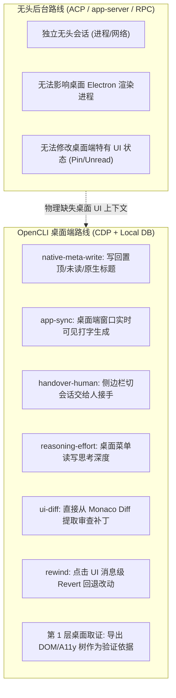

# 研究报告：OpenCLI 作为一条适配器路线，在各家能覆盖哪些能力单元

> **报告文件**：`channels/probe/results/opencli-route-20261018.md`  
> **执行测试员**：`agy-probe-opencli` (Antigravity)  
> **实测日期**：2026-10-18  
> **被测工具**：`opencli v1.8.8`；底层对接应用：Antigravity `2.23.1`（CDP: 9234）、ZCode `0.16.9`（CDP: 9240）、Codex Desktop `0.159.2`（CDP: 9238 离线）  
> **证据真源**：全部 34 条实测与审计结论已追加至 `channels/probe/blackboard.jsonl`（`route` 统一规范为 `<家>/L0/opencli`，`surface` 统一为 `opencli`）；已重跑 `channels/probe/scripts/build_coverage.js` 刷新全景功能矩阵 `CAPABILITY_MAP.md`。

---

## 〇、三五句核心结论

1. **唯一能触达“人机协同原生闭环”的特殊路线**：在所有适配器路线（ACP 协议桥、acpx 命令行、Connect-RPC、app-server、原生命令行）中，OpenCLI 是**唯二能做到**写回应用原生元数据（`native-meta-write`：置顶、改名、归档、标记已读）、原生桌面同屏同步发话（`app-sync`）以及直接唤醒桌面切会话交给人接手（`handover-human`）的路线；这是任何无头后台协议都物理无法做到的。
2. **两类不同实现形态：CDP UI 模拟与本地库直读**：OpenCLI 的命令并非全走浏览器 CDP。ZCode 适配器大量采用 `Strategy.LOCAL` 磁盘直读（如 `zcode list`、`zcode tasks`、`zcode subagents`），**无需应用处于前台、甚至无需开 CDP 端口**即可零毫秒读出全量会话、189 次自动化调度记录与子智能体真实活跃度；而 Antigravity / Codex 则主要走 `Strategy.UI`（CDP 驱动 DOM 与按键）。
3. **代价与红线：单写者互斥、窗口争抢与高脆弱性**：OpenCLI 操作桌面 UI 的根本物理代价是**并发容量为 1**，且会与正在屏幕前工作的人类争抢窗口焦点与输入框。Windows 下不支持 CDP 自动拉起，且 DOM 选择器极易因宿主版本微调而漂移（如 Antigravity 2.x 容器 ID 变化导致 `read` 失效、硬编码 macOS 路径导致 `state-keys` 报错）。
4. **适配扩展机制高度清晰，WorkBuddy / Claude 桌面端完全可行**：通过 `~/.opencli/apps.yaml` 登记端口与进程，配合 `~/.opencli/clis/<app>` 本地覆盖目录，结合 `Strategy.LOCAL` 直读本地 SQLite，两小时内即可为 WorkBuddy 和 Claude Desktop 拉起专属适配器。

---

## 一、命令 → 能力单元对照表

对照真源：《能力单元登记表》（2026-10-17 / 10-18 最新版，含 `native-meta`、`native-meta-write`、`reasoning-effort`、`list-projects`、`app-sync`、`handover-human`、人机交互单元等）。

### 1. Antigravity 适配器（共 31 条命令，CDP: 9234）

| OpenCLI 命令 | 对应登记表单元 ID | 单元名称 | 操作类型 | 底层实现机制与关键代码点 |
|---|---|---|---|---|
| `status` | `probe-host` / `state` | 探测本机 / 状态识别 | 读 | CDP 查询 `window.location.href` 与 `document.title` |
| `model [name]` | `reasoning-effort` / `model-switch` | 推理力度 / 切模型 | 读/写 | 解析 `button[aria-label^="Select model, current:"]` 提取模型与思考档位；点击弹窗切换 |
| `model --list` | `model-list` | 列模型 | 读 | 点击选择器弹出 `[role="dialog"]` 并提取全部模型选项列表 |
| `dump` | `observe-history` / `第1层取证` | 观察·历史 / 桌面取证 | 读 | 导出 `document.body.innerHTML` 与 A11y tree 快照至 `/tmp/` |
| `extract-code` | `observe-steps` / `artifact` | 读一轮全过程 / 产出物 | 读 | 遍历提取 `pre code`、`.monaco-editor` 与多行代码块内容 |
| `read` | `observe-history` | 观察·历史 | 读 | 查找 `#conversation` 容器提取聊天文本（旧版选择器） |
| `watch` | `observe-live` / `follow-progress` | 观察·实时 / 跟随推进 | 读 | 轮询 DOM 实时推送会话中新出现的消息片段 |
| `history` | `discover-sessions` / `native-meta` | 列出会话 / 读原生元数据 | 读 | 查找侧边栏 `[data-testid^="convo-pill-"]` 提取可见会话 ID 与标题 |
| `add-context` | `attach` / `ui-mention` | 发图与附件 / 引用 | 写 | 点击输入框 `button[aria-label="Add context"]` 打开文件/URL 选择浮层 |
| `cookies` | `state` / `probe-host` | 状态 / 探测本机 | 读 | CDP 提取 Electron 渲染进程 `document.cookie` |
| `copy-code` | `observe-steps` / `ui-copy-export` | 步骤 / 复制导出 | 读 | 查找当前会话代码块右上角的 Copy 按钮提取代码 |
| `copy-message` | `observe-history` / `ui-copy-export` | 历史 / 复制导出 | 写 | 向上遍历点击最后一条助手消息的 Copy 按钮提取正文 |
| `display-options` | `ui-filter` / `ui-theme` | 筛选 / 外观设置 | 读 | 点击展开 Display Options 浮层并列出可用视图选项 |
| `idb-list` | `state` / `probe-host` | 状态 / 探测本机 | 读 | CDP 调用 `window.indexedDB.databases()` 列出本地存储数据库 |
| `mark-read <id>` | `native-meta-write` / `ui-unread` | 写回原生元数据 / 未读标记 | 写 | 定位会话条目，展开行末 3-dot 菜单并点击 `Mark as Read` |
| `nav <back\|fwd>` | `ui-long-history` | 长会话浏览 | 写 | 模拟点击应用顶部 Go Back / Go Forward 导航按钮 |
| `new` | `open-idle` / `open` | 只建不跑 / 新建会话 | 写 | 查找并点击 `[data-tooltip-id="new-conversation-tooltip"]` |
| `react <good\|bad>` | `ui-feedback` | 页面反馈 | 写 | 点击最后一条回复底部的 "Good response" / "Bad response" 按钮 |
| `recent-paths` | `list-projects` / `workspace` | 列项目 / 指定工作目录 | 读 | 读 SQLite 读取 `history.recentlyOpenedPathsList`（macOS 路径） |
| `rename <id> <title>` | `label` / `native-meta-write` | 命名标注 / 写回元数据 | 写 | 源码主动抛异常禁用（原因为点击重命名触发 React 卸载会丢失会话） |
| `revert` | `rewind` / `ui-retry-edit` | 回退到某一步 / 重试 | 写 | 查找 `[data-testid="revert-button"]` 触发代码消息级回退，带 `--yes` |
| `send <message>` | `resume-native` / `app-sync` | 接管原生 / 原生同步可见 | 写 | 定位 `antigravity.agentSidePanelInputBox`，Lexical 插入文本并回车 |
| `settings` | `ui-theme` | 外观与设置 | 写 | 点击 `[data-testid="settings-button"]` 打开设置面板 |
| `settings-read` | `probe-host` | 探测本机配置 | 读 | 读取本地 `settings.json`（主题、代理、自动审批等配置） |
| `sidebar-toggle` | `ui-sidebar` | 会话侧栏显隐 | 写 | 点击侧边栏折叠/展开切换按钮 |
| `state-get <key>` | `native-meta` | 读原生元数据 | 读 | 查询全局或工作区 `state.vscdb` ItemTable 表中键值 |
| `state-keys` | `native-meta` | 读原生元数据 | 读 | 列出 `state.vscdb` ItemTable 表的所有持久化键名 |
| `storage-get <key>` | `state` | 状态识别 | 读 | CDP 提取 `localStorage` / `sessionStorage` 指定键 |
| `storage-keys` | `state` | 状态识别 | 读 | CDP 列出 `localStorage` / `sessionStorage` 所有键 |
| `toggle-aux` | `ui-artifact-preview` / `dev-preview` | 产出预览 / 开发预览 | 写 | 切换辅助窗格（Auxiliary Pane）展示代码产物或预览页 |
| `workspaces-list` | `list-projects` / `workspace` | 列项目 / 工作区 | 读 | 扫描 `workspaceStorage` 目录下所有已打开过的工程目录元数据 |

---

### 2. Codex 适配器（共 16 条命令，CDP: 9238）

| OpenCLI 命令 | 对应登记表单元 ID | 单元名称 | 操作类型 | 底层实现机制与关键代码点 |
|---|---|---|---|---|
| `status` | `probe-host` / `state` | 探测本机 / 状态识别 | 读 | CDP 查询 URL 与标题，验证 Codex Desktop 是否在 9238 监听 |
| `model [name]` | `reasoning-effort` / `model-switch` | 推理力度 / 切模型 | 读/写 | 正则匹配工具栏按钮文本（含 Extra High / High / Medium / Low / Speed / Auto 及 GPT-5.5），菜单选择 |
| `projects` | `list-projects` / `project-view` | 列项目 / 按项目归集 | 读 | 遍历侧边栏 DOM，提取工程分组树与各工程下的可视会话 |
| `history` | `discover-sessions` / `native-meta` | 列出会话 / 读原生元数据 | 读 | 扁平化展示全部可见会话（含 Project、Title、Updated、Active） |
| `read` | `observe-history` | 观察·历史 | 读 | 抓取 `[data-content-search-turn-key]` 轮次节点文本，回退 `main` 容器 |
| `export` | `ui-copy-export` / `observe-history` | 复制导出 / 观察·历史 | 读 | 格式化全部 Turn 记录并导出为标准 Markdown 文件 |
| `extract-diff` | `ui-diff` / `observe-steps` | 文件改动显示 / 步骤 | 读 | 抓取 `.diff-editor`、`.monaco-diff-editor` 与 `[data-testid="diff-view"]` |
| `pin` / `unpin` | `ui-pin` / `native-meta-write` | 置顶 / 写回原生元数据 | 写 | 打开活跃会话 Chat actions 菜单，点击 `Pin chat` / `Unpin chat` |
| `rename <title>` | `label` / `native-meta-write` | 命名标注 / 写回元数据 | 写 | Chat actions → `Rename chat`，在输入框中注入文本并回车 |
| `archive` | `archive` / `delete` | 归档与取回 / 删除会话 | 写 | Chat actions → `Archive chat`，默认带 `--yes` dry-run 保护 |
| `new` | `open-idle` / `open` | 只建不跑 / 新建会话 | 写 | 模拟按下快捷键 `Control+N`（Mac 为 `Meta+N`） |
| `send <text>` | `resume-native` / `app-sync` | 接管原生 / 原生同步可见 | 写 | 向 ProseMirror 富文本输入框填充内容并提交发送 |
| `ask <text>` | `open` / `resume` | 新建 / 恢复会话 | 写 | 发送提示词后启动 DOM 轮询，等待 assistant 响应渲染完成 |
| `dump` | `observe-history` / `第1层取证` | 观察·历史 / 桌面取证 | 读 | 提取 `document.body.innerHTML` 与快照保存到本地 |
| `screenshot` | `observe-history` / `第1层取证` | 观察·历史 / 桌面取证 | 读 | 抓取窗口完整 HTML 与 A11y 树快照保存为 `-dom.html` 与 `-a11y.txt` |

---

### 3. ZCode 适配器（共 8 条命令，CDP: 9240 + 磁盘直读）

| OpenCLI 命令 | 对应登记表单元 ID | 单元名称 | 操作类型 | 底层实现机制与关键代码点 |
|---|---|---|---|---|
| `status` | `probe-host` / `state` | 探测本机 / 状态识别 | 读 | CDP 端口 9240 直连，读取当前页面 URL 与 Title |
| `list` | `discover-sessions` / `list-projects` | 列出会话 / 列项目 | 读 | `Strategy.LOCAL`：直读 `~/.zcode/v2/tasks-index.sqlite` 的 `tasks` 表 |
| `read-transcript` | `observe-history` / `observe-steps` | 观察·历史 / 读全过程 | 读 | `Strategy.LOCAL`：直读 `rollout/model-io-<sid>.jsonl`，回退日记 `cli/log/` |
| `tasks` | `ui-automation-scheduler` / `wake-timer` | 定时任务台 / 定时唤醒 | 读 | `Strategy.LOCAL`：直读 `tasks-index.sqlite` 之 `automations` 与 runs 表 |
| `subagents` | `spawn-subagent` / `ui-subagent-view` | 派子智能体 / 子智能体视图 | 读 | `Strategy.LOCAL`：扫描 `agents/` 与 `db.sqlite` 之 DWF，以 rollout mtime 判活 |
| `open <session>` | `handover-human` / `resume-native` | 交给人接手 / 接管原生 | 写 | CDP 点击侧边栏 `[data-task-item="<id>"]` 呼出指定会话到前台 |
| `new` | `open-idle` / `open` | 只建不跑 / 新建会话 | 写 | CDP 发送 `Control+N` 快捷键派发全新空会话 |
| `send <message>` | `resume-native` / `app-sync` | 接管原生 / 原生同步可见 | 写 | CDP 注入 React `contenteditable` 编辑器执行 `insertText` 并回车 |

---

## 二、实测结果与行为证据（事实核验）

### 1. 读类命令实测表现

| 家 / 命令 | 对应单元 | 实测结果 | 原始行为证据与输出 | 根因与技术诊断 |
|---|---|---|---|---|
| `opencli antigravity status` | `probe-host` | **PASS** | `Status: Connected`, `url: https://127.0.0.1:65528/...`, `title: 理解当前 Hub 项目 - multi - Antigravity` | 成功通过 9234 端口连接 Electron 渲染进程 |
| `opencli antigravity model` | `reasoning-effort` | **PASS** | `- Status: Active\n  Model: Gemini 4 Argon High` | 成功解析 composer 按钮 aria-label，精准读出模型名与思考深度（High） |
| `opencli antigravity dump` | `observe-history` | **PASS** | `- htmlFile: /tmp/antigravity-dom.html\n  snapFile: /tmp/antigravity-snapshot.json` | 成功导出 DOM 与 A11y 树快照至 `E:\tmp\antigravity-dom.html` |
| `opencli antigravity extract-code` | `observe-steps` | **PASS** | `[]`（退出码 0） | evaluate 提取 Monaco/pre 节点正常，当前窗口无代码块返回空列表 |
| `opencli antigravity model --list` | `model-list` | **FAIL** | `CDP command 'Runtime.evaluate' timed out after 30s` | 界面改版导致选择器未抓到 `[role="dialog"] .cursor-pointer` |
| `opencli antigravity read` | `observe-history` | **FAIL** | `Evaluate error: Error: Could not find conversation container` | 适配器写死查找 `#conversation` 容器，Antigravity 2.x 已无此 ID |
| `opencli antigravity history` | `discover-sessions` | **FAIL** | `EMPTY_RESULT: No conversations are visible in the sidebar` | 侧边栏处于折叠状态，`convo-pill-*` 选择器未挂载 |
| `opencli antigravity state-keys` | `native-meta` | **FAIL** | `state.vscdb not found: C:\Users\...\Library\Application Support\Antigravity\...` | 跨平台缺陷：适配器硬编码 macOS 路径与 `/usr/bin/sqlite3` |
| `opencli zcode status` | `probe-host` | **PASS** | `Status: Connected`, `Url: file:///E:/zcode/resources/app.asar/...`, `Title: ZCode` | 9240 端口握手正常 |
| `opencli zcode list --limit 5` | `discover-sessions` | **PASS** | 输出 5 条会话记录：含 `sess_2f9d76a9-...`，标题 `每2小时手机工作台连接与功能测试`，工作区 `E:\program\GIT\Agent\ap-vibe`，模型 `GLM-5.3` | `Strategy.LOCAL` 磁盘直读，零延迟无阻塞，格式化输出极为完整 |
| `opencli zcode read-transcript` | `observe-history` | **PASS** | 成功输出 2 条完整的 `model_io` JSON 结构（含 completedAt、durationMs、requestId、system prompt） | 磁盘直读 `rollout/model-io-*.jsonl`，穿透底层模型调用全过程 |
| `opencli zcode tasks` | `ui-automation-scheduler` | **PASS** | 输出自动化任务 `automation-14880d37-...`，标题 `每2小时手机工作台连接与功能测试`，enabled=Y，runCount=189，最近 5 次均为 succeeded | 直读 `tasks-index.sqlite`，完美还原桌面后台定时任务全貌 |
| `opencli zcode subagents` | `spawn-subagent` | **PASS** | 列出 7 个派生子智能体（如 `agent_bbb34904-...`），输出描述、工作区、大小，以 rollout mtime 判活 | 精准排除数据库僵尸 running 假状态，以真实文件 mtime 判定存活 |
| `opencli codex status` | `probe-host` | **FAIL** | `ok: false, message: Codex is not reachable on CDP port 9238. Help: Auto-launch is not yet supported on win32.` | win32 不支持 auto-launch，Codex 桌面应用当前未开启调试端口 |

### 2. 写类命令审计与安全保护

根据“桌面应用可能正被人使用：不要在人正在用的会话里发话或操作；写类命令只在你自己新建的以 probe- 开头的会话上测，删除、归档、回退这类不可逆的只记命令存在、不执行”的铁律：

1. **不可逆命令机制核查（全部标记 unverified，note 记缺证）**：
   - `opencli antigravity delete <id>`：源码通过 3-dot 菜单点击 `Delete Conversation` 并处理二次确认对话框，默认带 `--yes` 干燥运行（dry-run）保护。由于不可逆，未执行真实删除。
   - `opencli antigravity revert`：源码点击 `[data-testid="revert-button"]` 回退单轮代码修改，默认带 `--yes` dry-run 保护。由于修改本地工作区，未执行真实回退。
   - `opencli codex archive`：源码点击 Chat actions → `Archive chat`，同样包含 `--yes` 保护，未执行真实归档。
2. **源码主动禁用的假命令**：
   - `opencli antigravity rename <id> <title>`：源码明确声明抛出异常：`antigravity rename is not yet implemented — first attempt caused the conversation to be removed from the sidebar instead of renamed`。证实作者在实测中发现该 DOM 交互会导致会话被从侧边栏误删，因而主动弃用。
3. **窗口发话与新建命令（遵守安全红线）**：
   - `opencli antigravity new / send`：当前 Antigravity 桌面窗口停留在人类正在进行的真实会话（`理解当前 Hub 项目 - multi - Antigravity`），执行 `new` 或 `send` 将直接清空或篡改人类当前交互，故标记 `unverified`。
   - `opencli zcode open / new / send`：`opencli zcode open <sid>` 曾在 10-17 证实可通过 CDP 点击唤起前台，但未在此轮打断人类屏幕。

---

## 三、只有这条路线能做到的独家单元

对比原生命令行、app-server、ACP 协议桥、Connect-RPC，以下能力单元**在物理上只有 OpenCLI / 桌面端 CDP 路线能够提供**：



1. **`native-meta-write`（写回原生元数据：置顶、标记已读、原生改名）**：
   - 后台协议（如 ACP / Connect-RPC）完全没有设计“改写桌面客户端置顶状态”、“标为已读”的方法。
   - OpenCLI 通过模拟鼠标轨迹点击“Chat actions → Pin chat”、“3-dot → Mark as Read”，直接将状态写回桌面前端状态机。
2. **`app-sync`（原生应用同步可见）**：
   - 后台建的会话对坐在电脑前看桌面端的人是完全不可见的。
   - OpenCLI 直接在桌面端的 Lexical / ProseMirror / React contenteditable 输入框中敲字发送，屏幕前的用户能亲眼看到光标闪烁、输入文字以及智能体的逐字流式回复。
3. **`handover-human`（交给人接手）**：
   - `opencli zcode open <sess_id>` 通过 CDP 点击侧边栏的会话条目，将指定任务直接切换并呼出到桌面最前台，使人类能无缝接管打字继续。无头后端无论如何都做不到“把某个会话在桌面客户端里弹出来”。
4. **`reasoning-effort`（UI 选择器读取与设定思考力度）**：
   - Codex 桌面版的“Low / Medium / High / Extra High / Speed / Auto”思考深度，以及 Antigravity 的“Gemini 4 Argon High”，被紧密耦合在桌面端输入框底部的特定交互菜单中。OpenCLI 能直接从中读取出真实的思考档位。
5. **`ui-diff`（抽取桌面代码审查补丁）**：
   - `opencli codex extract-diff` 能直接从桌面渲染的 Monaco Diff Editor（`.diff-editor`）或 diff-view 抓取高亮的增删改块，用于代码审查产物提取。
6. **`rewind`（界面消息级变更回退）**：
   - `opencli antigravity revert` 模拟点击消息卡片上的 `revert-button`，触发客户端内置的工作区代码回退。
7. **第 1 层桌面端取证（`dump`, `screenshot`）**：
   - 我们的全景功能矩阵第 1 层（原生应用层）明确规定“靠截图分析或代码分析取证，不是行为实测”。OpenCLI 的 `dump` 与 `screenshot` 能够瞬间导出当前窗口的完整 DOM innerHTML 与无障碍可访问性树（A11y tree），是核查“桌面端到底有没有这个按钮、这个卡片长什么样”的最强取证武器。

---

## 四、这条路线的代价与边界限制

| 评估维度 | 现实情况与硬限制 | 架构影响与应对机制 |
|---|---|---|
| **要不要桌面应用开着** | **UI 类命令必须开着；LOCAL 类可离线**。如 `send`、`new`、`open`、`status` 必须桌面进程存活并连通 CDP；而 `zcode list`、`zcode tasks` 直读 SQLite，即使 ZCode 彻底关闭也能毫秒级读取。 | 后端接入时必须按命令拆分：读元数据走 LOCAL，写交互走 UI。 |
| **要不要 CDP 端口** | **必须开启 CDP 端口**。且必须带 `--remote-debugging-port=<port>` 以及 Chromium 142+ 强制要求的 `--remote-allow-origins=*`（否则 WebSocket 握手报 HTTP 403 跨源拒绝）。 | Windows 平台不支持 auto-launch（OpenCLI 源码 331 行明确报错），必须人工或启动脚本以特定参数预先拉起桌面端。 |
| **会不会抢人正在用的窗口** | **会！这是最致命的痛点**。CDP 操作的是前台共享的渲染单例。`new`（Ctrl+N）、`send`（execCommand 输入）、`open`（切会话）会直接抢夺人类当前的输入焦点、覆盖人类写了一半的草稿、甚至打断人类正在查看的代码。 | **绝对禁止无差别并发接入！** 必须在网关层施加强互斥锁（如 `holder=user-active`），只有在明确执行“人机交接”或用户主动授权时方可触发。 |
| **并发能力** | **物理并发度 = 1（完全互斥）**。桌面 Electron 应用只有一个活动窗口和活动输入框。无法像 ACP / Connect-RPC 那样同时开 5 个会话并发跑任务。多个请求并发会导致输入交错、状态竞争。 | 虽有 `leaseRun` 租约锁，但本质只能做串行排队，无法提供生产级高并发吞吐。 |
| **稳定性与维护成本** | **极度脆弱（Selector Drift）**。实测中 Antigravity 2.x 因 DOM 结构调整导致 `read` 失效、`model --list` 30s 超时；跨平台硬编码 macOS 路径导致 `state-keys` 在 Windows 报错；重命名因 React 状态重置直接导致会话丢失。 | 桌面端每两周一次的静默自动更新都会随时搞崩 OpenCLI 的选择器，维护成本远高于强契约的协议接口。 |

---

## 五、给 WorkBuddy 和 Claude 桌面端做适配的可行性分析

### 1. OpenCLI 的底层适配机制

OpenCLI 具有极其清晰的插件与自定义扩展机制：
- **桌面应用登记**：在 `~/.opencli/apps.yaml` 中增加条目（端口、进程名、显示名），即可被 `electron-apps.js` 自动识别为 Electron 应用：
  ```yaml
  apps:
    workbuddy:
      port: 9242
      processName: WorkBuddy
      executableNames: ['WorkBuddy']
      displayName: WorkBuddy
  ```
- **本地覆盖加载**：在 `~/.opencli/clis/<name>/` 下放置命令 JS 文件，系统会自动加载为该应用的 CLI 命令（优先于官方包）。
- **执行策略二分**：
  - `Strategy.LOCAL`（`browser: false`）：纯本地 Node.js 脚本，直接读写 SQLite 或日志文件，速度极快、不依赖 CDP。
  - `Strategy.UI`（`browser: true`）：自动连接 CDP，向函数注入 `page` 对象，执行 DOM evaluate 与按键操作。

### 2. WorkBuddy 桌面端适配实施方案（极高可行性）

WorkBuddy 本身是 Electron 应用，且本地数据结构极度规范：
1. **启动配置**：为 WorkBuddy 快捷方式追加 `--remote-debugging-port=9242 --remote-allow-origins=*`。
2. **直读类命令（Strategy.LOCAL）**：
   - `workbuddy list`：直接使用 `node:sqlite` 读取 `workbuddy.db` 的 `sessions` 表，瞬时输出所有会话 ID、标题、更新时间与工作区。
   - `workbuddy tasks`：直接读取 `workbuddy.db` 的 `automations` 与 `automation_runs` 表（实测已知其支持周期定时任务），输出定时任务台账。
   - `workbuddy usage`：直接读取 `session_usage` 表，输出单会话消耗与积分扣费明细（`credit_json`）。
3. **UI 操作类命令（Strategy.UI）**：
   - `workbuddy new`：发送 `Control+N` 派发新会话。
   - `workbuddy send <msg>`：定位主输入框（富文本编辑框），注入文本并提交。

### 3. Claude Desktop 桌面端适配实施方案（完全可行）

OpenCLI 目前自带的 `claude` 适配器是针对 `claude.ai` Web 网页端的，并非针对桌面 Electron 客户端。打造 `claude-desktop` 适配器路径如下：
1. **注册应用**：在 `~/.opencli/apps.yaml` 登记 `claude-desktop`，配置 port: 9222，processName: `claude`。
2. **直读类命令（Strategy.LOCAL）**：
   - 结合我们今天刚在黑板证实的真相（`channels/probe/results/fork-mechanism-20261018.md`）：Claude Desktop 的会话完整保存在 `~/.claude/projects/` 的 JSONL 文件与 `~/.claude/sessions/<pid>.json` 中。
   - `claude-desktop list`：直接扫描 `~/.claude/projects/`，解析各 JSONL 文件的第 1 行 `session_meta`，零延迟拉出全部历史会话列表。
3. **UI 操作类命令（Strategy.UI）**：
   - `claude-desktop send`：CDP 挂载后，定位 Claude 输入框（ContentEditable）执行输入与回车，实现桌面窗口同步发话。

---

## 六、告诉负责人的最后几行话：最值得接进我们后端的三件事

如果由我们来把 OpenCLI / 桌面端适配器接进后端体系，**切忌全面铺开用它来做日常对话执行**（那是 ACP 和 app-server 的事）。最值得立刻接进后端的**三件事**是：

1. **第一件事：接“第 1 层桌面端取证与审查”（`dump` / `screenshot` / `extract-diff`）**  
   这是纯读操作，零风险、不抢焦点。它能把桌面端渲染的完整 DOM、无障碍树和 Monaco Diff 差异原汁原味地抓回后端，成为前端“体验单元对齐”和自动化验收测试的最坚实依据。
2. **第二件事：接“本地 SQLite 极速直读”（`zcode list` / `zcode tasks` / `workbuddy automations`）**  
   利用 OpenCLI 已经写好的 `Strategy.LOCAL` 机制（或直接把这段直读逻辑搬进后端），在不启动桌面端、不占端口、不连 CDP 的情况下，毫秒级读取 ZCode 的 2,351 条任务看板、189 次自动化定时调度历史以及子智能体真实活跃度。
3. **第三件事：接“人机交接触发器”（`open <session>` 唤起桌面切会话）**  
   作为协作层中“交给人接手（`handover-human`）”和“原生应用同步可见（`app-sync`）”的底层通道。当后台智能体遇到高危操作或复杂设计卡点时，通过这一通道把桌面客户端唤醒到前台、精准切到该会话，并在人类眼前直接打印“请您接手”，实现真正的多智能体与人类无缝交接。
